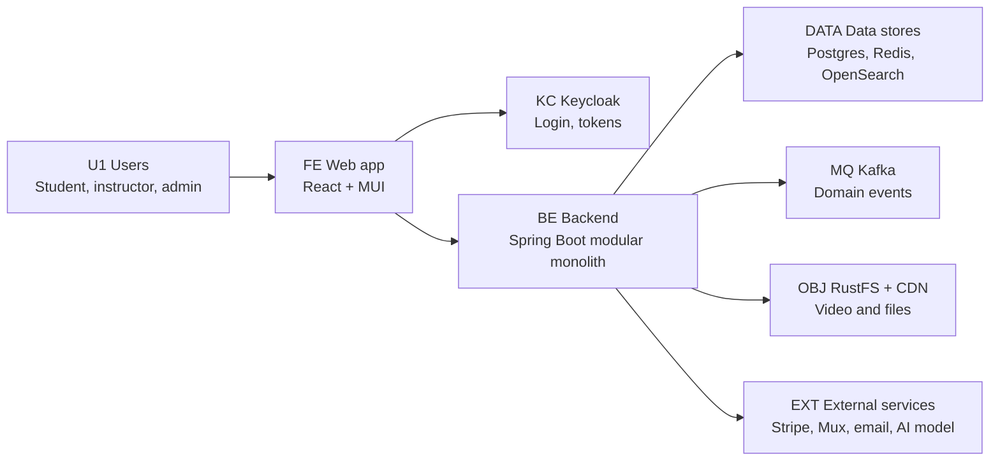
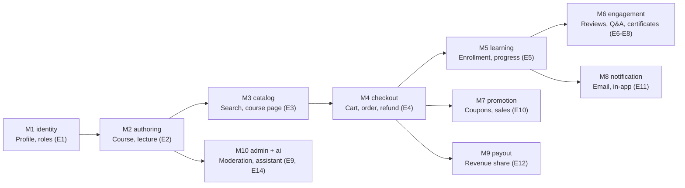
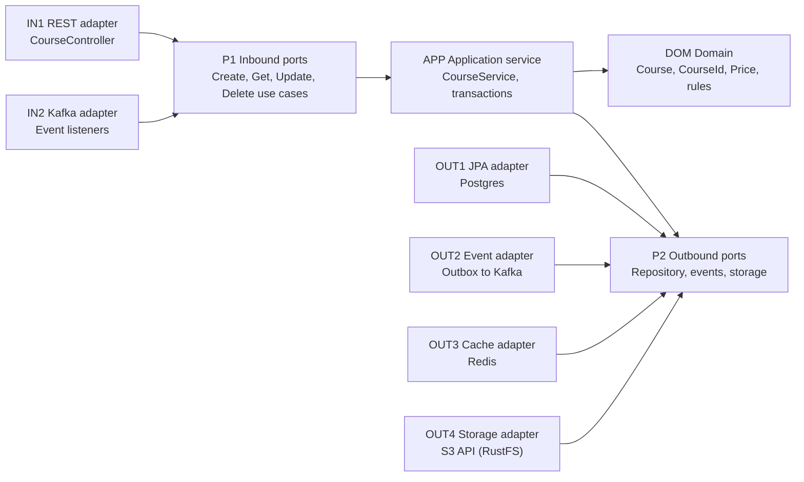
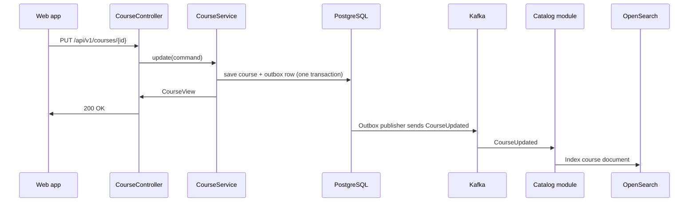
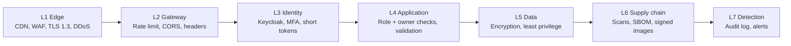
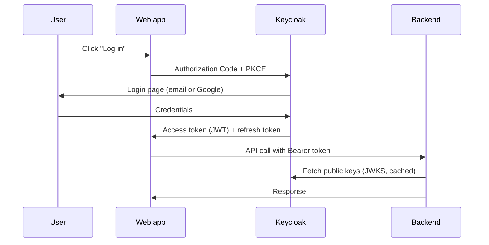
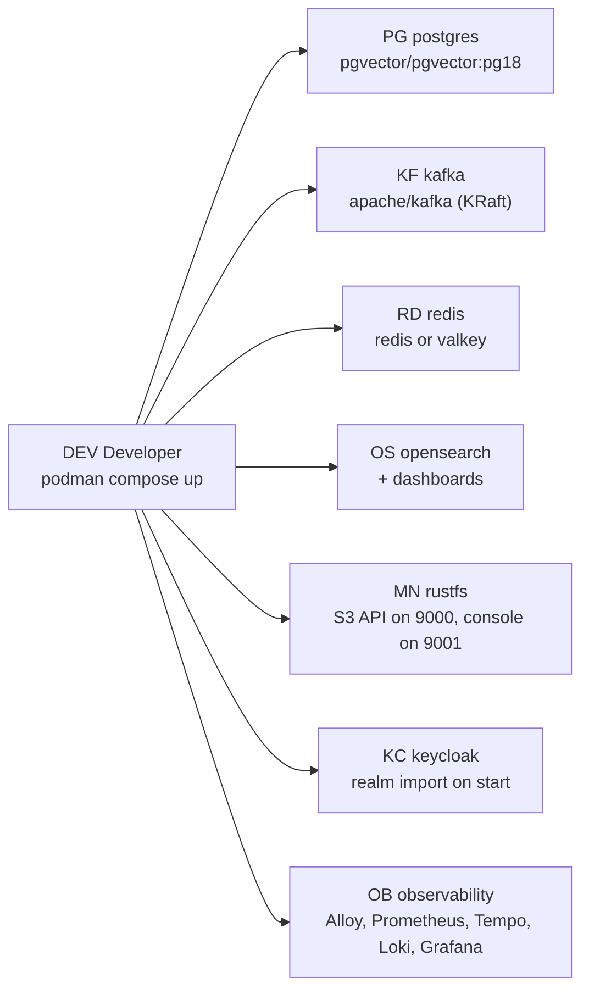
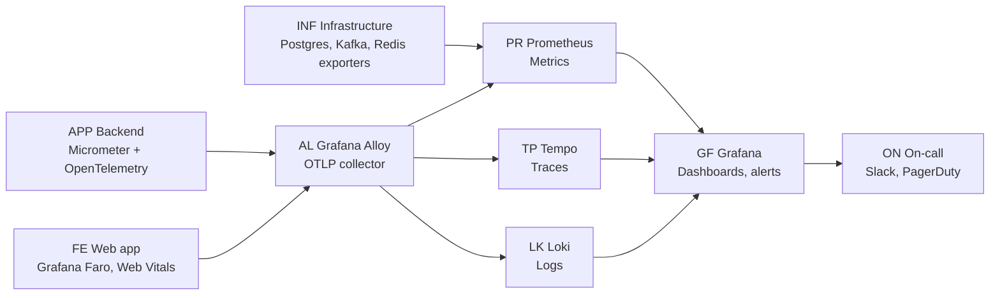

# Online Course Marketplace — Solution Architecture

| Item | Value |
|---|---|
| Document type | Solution architecture |
| Input | [course-marketplace-plan.md](course-marketplace-plan.md) |
| Status | Draft v0.1 |
| Date | 2026-11-23 |

---

## 1. Summary

- **Frontend:** React + TypeScript + Material UI (MUI), built with Vite.
- **Backend:** Java 25 + Spring Boot 4, one modular monolith. Each module uses Hexagonal Architecture (ports and adapters).
- **Data:** PostgreSQL is the source of truth. Redis caches. OpenSearch searches. RustFS stores files and video.
- **Integration:** Kafka carries domain events between modules and to external consumers. The transactional outbox makes sure that no event is lost.
- **Identity:** Keycloak issues OpenID Connect (OIDC) tokens. The backend is an OAuth2 resource server.
- **AI:** Spring AI with pgvector gives course Q&A assistant, semantic search, and content moderation.
- **Security:** defense in depth, mapped to OWASP Top 10 (2025). Section 6.
- **Observability:** Prometheus (metrics), Tempo (traces), Loki (logs), Grafana (dashboards, alerts), collected with OpenTelemetry. Section 11.

Section 9 gives a full CRUD example for the `Course` entity.

---

## 2. Technology stack

### 2.1 Requested stack

| Layer | Technology | Use in this project |
|---|---|---|
| Frontend | React 19, TypeScript, MUI 7 | Student, instructor, and admin UI |
| Backend | Java 25 (LTS), Spring Boot 4 | Business rules, REST API |
| Database | PostgreSQL 18 | Users, courses, orders, enrollments |
| Messaging | Apache Kafka 4 (KRaft mode, no ZooKeeper) | Domain events: `CoursePublished`, `OrderPaid`, `LectureCompleted` |
| Cache | Redis 8 (or Valkey 8) | Course page cache, cart, rate limits, sessions |
| Search | OpenSearch 3 | Catalog search, filters, typo tolerance (US-3.1, US-3.2) |
| Object storage | RustFS (S3 API) | Raw uploads, HLS segments, attachments, certificates |
| Identity | Keycloak 26 | Sign up, log in, Google login, roles (E1) |
| AI | Spring AI 1.x | Q&A assistant, semantic search, moderation |

### 2.2 Added trending technologies

Group A — backend platform

| Technology | Why |
|---|---|
| **Spring Modulith** | Enforces module boundaries in the monolith. Gives the event publication registry (outbox) and module tests. |
| **Virtual threads (Project Loom)** | High concurrency for I/O calls (Stripe, RustFS, OpenSearch) without reactive code. One property: `spring.threads.virtual.enabled=true`. |
| **GraalVM native image** (optional) | Fast start and low memory for small workers (video webhook, notification sender). |
| **Flyway** | Versioned database migrations. |
| **MapStruct** | Compile-time mapping between domain, JPA entities, and DTOs. No reflection. |

Group B — data and events

| Technology | Why |
|---|---|
| **pgvector** | Vector search inside PostgreSQL. No separate vector database for Release 1–2. |
| **Debezium** (Release 3) | Change data capture from the outbox table to Kafka, when event volume grows. |
| **Apicurio Registry** | Schema registry for Kafka events (Avro or JSON Schema). Prevents breaking changes. |
| **Temporal** (Release 3) | Durable workflows for monthly payouts (E12) and video processing retries. |

Group C — quality and operations

| Technology | Why |
|---|---|
| **Testcontainers** | Integration tests with real PostgreSQL, Kafka, Redis, OpenSearch, RustFS, Keycloak. RustFS runs as a GenericContainer with `docker.io/rustfs/rustfs:1.0.6`. |
| **ArchUnit** | Tests that fail the build when a domain class imports Spring or JPA. |
| **OpenTelemetry + Prometheus, Grafana, Tempo, Loki** | Metrics, traces, logs in one Grafana UI. Structured JSON logs. Section 11. |
| **Semgrep / CodeQL, OWASP ZAP, Gitleaks** | Static scan, dynamic scan, secret scan in CI. Section 6. |
| **HashiCorp Vault / OpenBao + External Secrets Operator** | Secrets out of Git and out of images. |
| **Resilience4j** | Circuit breaker and retry for Stripe, Mux, AI provider. |
| **Unleash** | Feature flags. Release features to a percentage of users. |

Group D — frontend

| Technology | Why |
|---|---|
| **Vite** | Fast dev server and build. |
| **TanStack Query** | Server state, cache, retries. |
| **React Hook Form + Zod** | Forms with typed validation. |
| **Orval** | Generates a typed API client and TanStack Query hooks from the backend OpenAPI file. |
| **Playwright + Storybook** | End-to-end tests and component catalog. |

Group E — delivery

| Technology | Why |
|---|---|
| **Podman + `compose.yaml`** | Local stack in one command (`podman compose up`). Local container engine is Podman. |
| **Kubernetes + Argo CD** | GitOps deployment. |
| **GitHub Actions** | CI: build, test, scan, image push. |
| **Trivy + Renovate** | Image scan and automatic dependency updates. |

### 2.3 Technology risks

| Risk | Mitigation |
|---|---|
| RustFS is young (1.0 in 2026). It replaced MinIO: the MinIO community edition went into maintenance mode in 2025, and its Docker Hub images are no longer published. | Use only the S3 API, behind ports (`FileStoragePort`, `AvatarStoragePort`). Switch to AWS S3, SeaweedFS, or Garage without domain change. |
| Redis license changed (RSAL/SSPL, AGPL from Redis 8). | Valkey 8 is a drop-in, BSD-licensed alternative. The cache adapter hides the choice. |
| AI provider cost and data privacy. | Spring AI abstracts the provider. Start with a hosted model; keep the option of a self-hosted model through Ollama. |

---

## 3. System context

### Level 1 — System overview



### Level 2 — Backend modules (one per epic group)



Rules for modules:
- A module calls another module only through its public API package (`<module>.api`) or through events.
- A module owns its database schema. No module reads another module's tables.
- Spring Modulith `ApplicationModules.verify()` checks these rules in a test.

---

## 4. Hexagonal Architecture (backend)

### 4.1 Principle

The domain is in the center. It has no dependency on Spring, JPA, Kafka, or HTTP. The domain declares **ports** (Java interfaces). **Adapters** implement the ports with a technology.

- **Inbound port (driving):** a use case that the outside world calls. Example: `CreateCourseUseCase`.
- **Outbound port (driven):** a service that the domain needs. Example: `CourseRepository`.
- **Inbound adapter:** REST controller, Kafka listener, scheduled job.
- **Outbound adapter:** JPA repository, Kafka publisher, OpenSearch client, S3 client (RustFS), Redis cache.

Dependencies always point inward: `adapter → application → domain`.

### 4.2 Layer diagram



Arrow direction = compile-time dependency. Adapters depend on ports. Ports never depend on adapters.

### 4.3 Package structure (one module)

```text
com.marketplace.authoring
├── api/                         # public API for other modules (events, query facade)
│   └── CoursePublishedEvent.java
├── domain/                      # pure Java, no framework imports
│   ├── model/
│   │   ├── Course.java
│   │   ├── CourseId.java
│   │   ├── CourseStatus.java
│   │   └── Price.java
│   └── exception/
│       ├── CourseNotFoundException.java
│       └── CourseRuleViolationException.java
├── application/
│   ├── port/
│   │   ├── in/                  # use cases
│   │   │   ├── CreateCourseUseCase.java
│   │   │   ├── GetCourseUseCase.java
│   │   │   ├── UpdateCourseUseCase.java
│   │   │   └── DeleteCourseUseCase.java
│   │   └── out/                 # needs of the domain
│   │       ├── CourseRepository.java
│   │       └── CourseEventPublisher.java
│   └── service/
│       └── CourseService.java
└── adapter/
    ├── in/web/                  # REST
    │   ├── CourseController.java
    │   ├── CourseRequest.java
    │   ├── CourseResponse.java
    │   └── CourseProblemHandler.java
    └── out/
        ├── persistence/         # JPA
        │   ├── CourseJpaEntity.java
        │   ├── CourseJpaRepository.java
        │   ├── CourseEntityMapper.java
        │   └── CoursePersistenceAdapter.java
        └── event/               # Spring Modulith outbox -> Kafka
            └── SpringCourseEventPublisher.java
```

### 4.4 Architecture rules (enforced by ArchUnit)

| Rule | Check |
|---|---|
| Domain is pure | `domain..` does not depend on `org.springframework..`, `jakarta.persistence..`, `org.apache.kafka..` |
| Adapters are isolated | `adapter.in..` does not depend on `adapter.out..` |
| Ports are interfaces | Classes in `port..` are interfaces or records |
| Controllers use ports | `adapter.in.web..` depends only on `port.in..`, not on `service..` |

---

## 5. Data and event flow

### 5.1 Write a course and update search



Why outbox: the database commit and the Kafka send cannot be one transaction. The outbox row is in the same transaction as the course. A publisher sends it to Kafka after commit, and retries on failure.

### 5.2 Kafka topics (Release 1)

| Topic | Producer | Consumers |
|---|---|---|
| `authoring.course.v1` | authoring | catalog (index), admin (review queue), ai (embeddings) |
| `checkout.order.v1` | checkout | learning (enroll), notification (receipt), payout |
| `learning.progress.v1` | learning | engagement (certificate), analytics |
| `media.video.v1` | media worker | authoring (lecture status "Ready") |

Key = aggregate id, so that events for one course stay in order.

### 5.3 Redis use

| Key pattern | Content | TTL |
|---|---|---|
| `course:page:{id}` | Course page JSON (US-3.5) | 10 min, evicted on `CourseUpdated` |
| `cart:{userId}` | Cart items (US-4.1) | 30 days |
| `ratelimit:{ip}:{route}` | Request counter | 1 min |
| `video:token:{userId}:{lectureId}` | Signed URL cache | 5 min |

### 5.4 RustFS buckets

| Bucket | Content | Access |
|---|---|---|
| `uploads-raw` | Original instructor video | Private. Presigned PUT URL for direct browser upload. |
| `video-hls` | HLS segments after transcode | Private. CDN with signed URLs. |
| `attachments` | PDF, code files | Private. Presigned GET URL for enrolled students. |
| `public-assets` | Course images, avatars | Public read through CDN. |

The browser uploads video directly to RustFS with an S3 presigned URL. The backend does not stream 4 GB files.

---

## 6. Security

### 6.1 Security layers



### 6.2 Controls mapped to OWASP Top 10 (2025)

| OWASP risk | Control in this project |
|---|---|
| A01 Broken Access Control | Role check (`@PreAuthorize`) at the adapter. Owner check in the domain (`Course.requireOwner`). Deny by default. Test for each endpoint: "other user gets 403". |
| A02 Security Misconfiguration | Actuator endpoints on a separate management port, not public. Security headers: CSP, HSTS, `frame-ancestors 'none'`, `X-Content-Type-Options`. No default passwords in any container. |
| A03 Software Supply Chain Failures | SBOM (CycloneDX) per build. Trivy image scan. Renovate updates. Images signed with Sigstore cosign; the cluster accepts only signed images. |
| A04 Cryptographic Failures | TLS everywhere, also Kafka, Redis, OpenSearch, PostgreSQL. Encryption at rest: disk encryption, S3 server-side encryption (SSE) with a KMS key. Passwords stay in Keycloak (argon2/PBKDF2). |
| A05 Injection | JPA parameter binding only. Bean Validation on every request. Zod on the frontend. OpenSearch queries built with the typed client, not string concatenation. |
| A06 Insecure Design | Threat model (STRIDE) per epic before Sprint start. Refund and coupon abuse rules in the domain. |
| A07 Authentication Failures | Keycloak brute-force detection. MFA (TOTP or passkeys) required for `instructor`, `admin`, `finance`. Access token 5 min, refresh token rotation. |
| A08 Software or Data Integrity Failures | Stripe and Mux webhooks: verify signature and timestamp. Kafka event schemas in Apicurio Registry. |
| A09 Logging and Alerting Failures | Audit log for login, role change, price change, refund, payout, admin action. Alerts in Grafana (Section 11). |
| A10 Mishandling of Exceptional Conditions | One Problem Details handler per module. No stack trace to the client. Fail closed: if the authorization check fails with an error, deny. |

### 6.3 Platform controls

| Area | Control |
|---|---|
| Browser tokens | Recommended: Backend-for-Frontend (BFF) with Spring Cloud Gateway token relay. The browser holds only an `HttpOnly`, `SameSite=Strict` session cookie, not the JWT (OAuth 2.0 for Browser-Based Apps BCP). |
| Rate limits | Bucket4j with Redis: login, search, checkout, AI assistant. 429 with `Retry-After`. |
| Video protection | Signed CDN URLs, 5 min life, bound to the user. No direct RustFS access from the browser except presigned upload. |
| Secrets | Vault (or OpenBao) + External Secrets Operator. Gitleaks blocks a commit with a secret. |
| Network | Kubernetes NetworkPolicy: deny all, then allow per service. Kafka ACL per module (a module writes only its own topics). |
| Personal data | GDPR: data export and erase per module on `UserDeleted`. No personal data in logs, metric labels, or AI prompts (redact before the call). |
| AI | Prompt-injection guard: system prompt is fixed; retrieved text is data. Moderation on AI output. Per-user AI rate limit and cost budget. |
| CI security gates | Semgrep or CodeQL (SAST), OWASP ZAP baseline (DAST) on the test environment, Trivy (images), dependency check. A high finding fails the build. |

### 6.4 Login flow with Keycloak



| Item | Decision |
|---|---|
| Realm | `marketplace` |
| Clients | `web-app` (public, PKCE), `backend` (bearer-only), `admin-cli` |
| Realm roles | `student`, `instructor`, `admin`, `finance` |
| Become instructor (US-1.5) | Backend calls Keycloak Admin API to add role `instructor` |
| Google login (US-1.2) | Keycloak identity provider "Google" |
| Account deletion (US-1.7) | Backend deletes Keycloak user and publishes `UserDeleted`; each module erases its data |

Backend maps Keycloak realm roles to Spring authorities:

```java
@Bean
SecurityFilterChain apiSecurity(HttpSecurity http) throws Exception {
    http.authorizeHttpRequests(auth -> auth
            .requestMatchers(HttpMethod.GET, "/api/v1/catalog/**").permitAll()
            .requestMatchers("/api/v1/courses/**").hasRole("instructor")
            .requestMatchers("/api/v1/admin/**").hasRole("admin")
            .anyRequest().authenticated())
        .oauth2ResourceServer(oauth -> oauth.jwt(jwt ->
            jwt.jwtAuthenticationConverter(new KeycloakRoleConverter())));
    return http.build();
}
```

---

## 7. AI features with Spring AI

| Feature | Story link | How |
|---|---|---|
| Course Q&A assistant | E7 (US-7.1) | RAG: lecture transcripts → embeddings in pgvector → `ChatClient` answers with sources. Instructor can review answers. |
| Semantic search | E3 (US-3.1) | Hybrid: OpenSearch keyword score + vector score (OpenSearch k-NN or pgvector). |
| Content moderation | E9, E6 | Classify reviews and questions as abusive or not; send hits to the admin queue. |
| Course description helper | E2 (US-2.7) | Generate draft description and learning goals from the curriculum. |
| Transcript and captions | NFR accessibility | Speech-to-text on upload; store WebVTT in RustFS. |

AI is an outbound port, like any other adapter:

```java
// application/port/out
public interface CourseAssistantPort {
    String answer(CourseId courseId, String question);
}

// adapter/out/ai
@Component
class SpringAiCourseAssistant implements CourseAssistantPort {
    private final ChatClient chatClient;
    private final VectorStore lectureVectorStore;

    SpringAiCourseAssistant(ChatClient.Builder builder, VectorStore lectureVectorStore) {
        this.lectureVectorStore = lectureVectorStore;
        this.chatClient = builder
            .defaultSystem("Answer only from the course material. Say 'I do not know' otherwise.")
            .build();
    }

    @Override
    public String answer(CourseId courseId, String question) {
        SearchRequest courseScope = SearchRequest.builder()
            .query(question)
            .topK(5)
            .filterExpression("courseId == '" + courseId.value() + "'")
            .build();
        return chatClient.prompt()
            .user(question)
            .advisors(QuestionAnswerAdvisor.builder(lectureVectorStore).searchRequest(courseScope).build())
            .call()
            .content();
    }
}
```

The domain does not know that an LLM exists. A test uses a `FakeCourseAssistant`.

---

## 8. Frontend architecture

```text
frontend/src
├── app/              # router, theme (MUI), providers (QueryClient, auth)
├── shared/
│   ├── api/          # Orval-generated client + hooks (do not edit)
│   ├── auth/         # oidc-client-ts wrapper for Keycloak
│   └── ui/           # shared MUI components
└── features/
    ├── catalog/      # search page, course page
    ├── authoring/    # instructor course editor
    ├── checkout/     # cart, payment redirect
    ├── learning/     # player (hls.js), progress
    └── admin/        # review queue
```

| Concern | Choice |
|---|---|
| Server state | TanStack Query (hooks generated by Orval from `openapi.yaml`) |
| Client state | React state; Zustand only if shared UI state grows |
| Forms | React Hook Form + Zod (same rules as backend Bean Validation) |
| Video | hls.js in a MUI player shell (speed, quality, resume — US-5.2, US-5.3) |
| Auth | BFF session cookie (Section 6.3). Fallback: oidc-client-ts, Authorization Code + PKCE, token in memory |
| Accessibility | MUI components + eslint-plugin-jsx-a11y + axe in Playwright (WCAG 2.2 AA) |

---

## 9. CRUD example — `Course` (authoring module)

Scope: create, read, update, delete a **draft** course (US-2.1, US-2.6). Rule: only the owner instructor can change it, and only in status `DRAFT`.

### 9.1 REST contract

| Method | Path | Body | Result |
|---|---|---|---|
| POST | `/api/v1/courses` | `CourseRequest` | 201 + `Location` header |
| GET | `/api/v1/courses/{id}` | — | 200 `CourseResponse` |
| GET | `/api/v1/courses?page=0&size=20` | — | 200 page of my courses |
| PUT | `/api/v1/courses/{id}` | `CourseRequest` | 200 `CourseResponse` |
| DELETE | `/api/v1/courses/{id}` | — | 204 |

Errors use RFC 9457 Problem Details (`application/problem+json`).

### 9.2 Domain

```java
package com.marketplace.authoring.domain.model;

public record CourseId(UUID value) {
    public CourseId {
        Objects.requireNonNull(value, "CourseId value must not be null");
    }

    public static CourseId newId() {
        return new CourseId(UUID.randomUUID());
    }
}
```

```java
package com.marketplace.authoring.domain.model;

/** Price from the fixed price list (US-2.6). Amount in minor units, e.g. 1999 = 19.99. */
public record Price(long amountMinor, String currency) {
    private static final Set<Long> ALLOWED_TIERS = Set.of(0L, 1999L, 2999L, 4999L, 9999L, 19999L);

    public Price {
        if (!ALLOWED_TIERS.contains(amountMinor)) {
            throw new CourseRuleViolationException(
                "Price " + amountMinor + " is not in the price list " + ALLOWED_TIERS);
        }
        if (!"USD".equals(currency)) {
            throw new CourseRuleViolationException("Currency '" + currency + "' is not supported; expected 'USD'");
        }
    }
}
```

```java
package com.marketplace.authoring.domain.model;

/** Course aggregate. Holds the rules for a draft course. No framework imports. */
public class Course {
    private final CourseId id;
    private final UUID instructorId;
    private String title;
    private String subtitle;
    private String category;
    private String language;
    private CourseLevel level;
    private Price price;
    private CourseStatus status;
    private final long version;

    // Constructor and getters omitted for brevity.

    public static Course createDraft(UUID instructorId, CourseDetails details) {
        return new Course(CourseId.newId(), instructorId, details, CourseStatus.DRAFT, 0L);
    }

    public void updateDetails(UUID actorId, CourseDetails details) {
        requireOwner(actorId);
        requireDraft();
        applyDetails(details);
    }

    public void ensureDeletableBy(UUID actorId) {
        requireOwner(actorId);
        requireDraft();
    }

    private void requireOwner(UUID actorId) {
        if (!instructorId.equals(actorId)) {
            throw new CourseAccessDeniedException(
                "User " + actorId + " is not the owner of course " + id.value());
        }
    }

    private void requireDraft() {
        if (status != CourseStatus.DRAFT) {
            throw new CourseRuleViolationException(
                "Course " + id.value() + " has status " + status + "; expected DRAFT");
        }
    }

    private void applyDetails(CourseDetails details) {
        this.title = details.title();
        this.subtitle = details.subtitle();
        this.category = details.category();
        this.language = details.language();
        this.level = details.level();
        this.price = details.price();
    }
}
```

```java
/** Value object for the editable fields. Validates the title length. */
public record CourseDetails(String title, String subtitle, String category,
                            String language, CourseLevel level, Price price) {
    public CourseDetails {
        if (title == null || title.isBlank() || title.length() > 120) {
            throw new CourseRuleViolationException(
                "Title '" + title + "' is invalid; expected 1-120 characters");
        }
    }
}
```

### 9.3 Ports

```java
package com.marketplace.authoring.application.port.in;

public interface CreateCourseUseCase {
    CourseView create(UUID instructorId, CourseDetails details);
}

public interface GetCourseUseCase {
    CourseView getById(UUID actorId, CourseId id);
    PageResult<CourseView> listByInstructor(UUID instructorId, PageQuery pageQuery);
}

public interface UpdateCourseUseCase {
    CourseView update(UUID actorId, CourseId id, CourseDetails details);
}

public interface DeleteCourseUseCase {
    void delete(UUID actorId, CourseId id);
}
```

```java
package com.marketplace.authoring.application.port.out;

public interface CourseRepository {
    Course save(Course course);
    Optional<Course> findById(CourseId id);
    PageResult<Course> findByInstructor(UUID instructorId, PageQuery pageQuery);
    void delete(CourseId id);
}

public interface CourseEventPublisher {
    void publish(CourseChangedEvent event);
}
```

`CourseView`, `PageQuery`, and `PageResult` are plain records in the application layer. The REST adapter never sees the `Course` aggregate.

### 9.4 Application service

```java
package com.marketplace.authoring.application.service;

/** Runs the course use cases. Owns the transaction boundary. */
@Service
@Transactional
class CourseService implements CreateCourseUseCase, GetCourseUseCase,
                               UpdateCourseUseCase, DeleteCourseUseCase {
    private final CourseRepository courseRepository;
    private final CourseEventPublisher courseEventPublisher;

    CourseService(CourseRepository courseRepository, CourseEventPublisher courseEventPublisher) {
        this.courseRepository = courseRepository;
        this.courseEventPublisher = courseEventPublisher;
    }

    @Override
    public CourseView create(UUID instructorId, CourseDetails details) {
        Course saved = courseRepository.save(Course.createDraft(instructorId, details));
        courseEventPublisher.publish(CourseChangedEvent.created(saved));
        return CourseView.from(saved);
    }

    @Override
    @Transactional(readOnly = true)
    public CourseView getById(UUID actorId, CourseId id) {
        Course course = loadCourse(id);
        course.ensureReadableBy(actorId);
        return CourseView.from(course);
    }

    @Override
    @Transactional(readOnly = true)
    public PageResult<CourseView> listByInstructor(UUID instructorId, PageQuery pageQuery) {
        return courseRepository.findByInstructor(instructorId, pageQuery).map(CourseView::from);
    }

    @Override
    public CourseView update(UUID actorId, CourseId id, CourseDetails details) {
        Course course = loadCourse(id);
        course.updateDetails(actorId, details);
        Course saved = courseRepository.save(course);
        courseEventPublisher.publish(CourseChangedEvent.updated(saved));
        return CourseView.from(saved);
    }

    @Override
    public void delete(UUID actorId, CourseId id) {
        Course course = loadCourse(id);
        course.ensureDeletableBy(actorId);
        courseRepository.delete(id);
        courseEventPublisher.publish(CourseChangedEvent.deleted(id));
    }

    private Course loadCourse(CourseId id) {
        return courseRepository.findById(id)
            .orElseThrow(() -> new CourseNotFoundException("Course " + id.value() + " does not exist"));
    }
}
```

Note: `@Service` and `@Transactional` are the only Spring imports in the application layer. A strict team can move them into a `@Configuration` class in the adapter layer and keep the service framework-free.

### 9.5 Inbound adapter — REST

```java
package com.marketplace.authoring.adapter.in.web;

public record CourseRequest(
    @NotBlank @Size(max = 120) String title,
    @Size(max = 200) String subtitle,
    @NotBlank String category,
    @NotBlank String language,
    @NotNull CourseLevel level,
    @NotNull @PositiveOrZero Long priceMinor) {

    CourseDetails toDetails() {
        return new CourseDetails(title, subtitle, category, language, level, new Price(priceMinor, "USD"));
    }
}
```

```java
@RestController
@RequestMapping("/api/v1/courses")
class CourseController {
    private final CreateCourseUseCase createCourse;
    private final GetCourseUseCase getCourse;
    private final UpdateCourseUseCase updateCourse;
    private final DeleteCourseUseCase deleteCourse;

    // Constructor injection omitted for brevity.

    @PostMapping
    ResponseEntity<CourseResponse> create(@AuthenticationPrincipal Jwt jwt,
                                          @Valid @RequestBody CourseRequest request) {
        CourseView created = createCourse.create(userId(jwt), request.toDetails());
        URI location = URI.create("/api/v1/courses/" + created.id());
        return ResponseEntity.created(location).body(CourseResponse.from(created));
    }

    @GetMapping("/{id}")
    CourseResponse get(@AuthenticationPrincipal Jwt jwt, @PathVariable UUID id) {
        return CourseResponse.from(getCourse.getById(userId(jwt), new CourseId(id)));
    }

    @GetMapping
    PageResponse<CourseResponse> listMine(@AuthenticationPrincipal Jwt jwt,
                                          @RequestParam(defaultValue = "0") int page,
                                          @RequestParam(defaultValue = "20") int size) {
        PageResult<CourseView> courses = getCourse.listByInstructor(userId(jwt), new PageQuery(page, size));
        return PageResponse.from(courses, CourseResponse::from);
    }

    @PutMapping("/{id}")
    CourseResponse update(@AuthenticationPrincipal Jwt jwt, @PathVariable UUID id,
                          @Valid @RequestBody CourseRequest request) {
        CourseView updated = updateCourse.update(userId(jwt), new CourseId(id), request.toDetails());
        return CourseResponse.from(updated);
    }

    @DeleteMapping("/{id}")
    @ResponseStatus(HttpStatus.NO_CONTENT)
    void delete(@AuthenticationPrincipal Jwt jwt, @PathVariable UUID id) {
        deleteCourse.delete(userId(jwt), new CourseId(id));
    }

    private static UUID userId(Jwt jwt) {
        return UUID.fromString(jwt.getSubject());
    }
}
```

```java
/** Maps domain exceptions to RFC 9457 Problem Details. */
@RestControllerAdvice(assignableTypes = CourseController.class)
class CourseProblemHandler {

    @ExceptionHandler(CourseNotFoundException.class)
    ProblemDetail notFound(CourseNotFoundException ex) {
        return ProblemDetail.forStatusAndDetail(HttpStatus.NOT_FOUND, ex.getMessage());
    }

    @ExceptionHandler(CourseAccessDeniedException.class)
    ProblemDetail forbidden(CourseAccessDeniedException ex) {
        return ProblemDetail.forStatusAndDetail(HttpStatus.FORBIDDEN, ex.getMessage());
    }

    @ExceptionHandler(CourseRuleViolationException.class)
    ProblemDetail ruleViolation(CourseRuleViolationException ex) {
        return ProblemDetail.forStatusAndDetail(HttpStatus.UNPROCESSABLE_ENTITY, ex.getMessage());
    }
}
```

### 9.6 Outbound adapter — PostgreSQL (JPA)

```sql
-- V1__create_course.sql (Flyway)
CREATE SCHEMA IF NOT EXISTS authoring;

CREATE TABLE authoring.course (
    id             UUID PRIMARY KEY,
    instructor_id  UUID         NOT NULL,
    title          VARCHAR(120) NOT NULL,
    subtitle       VARCHAR(200),
    category       VARCHAR(60)  NOT NULL,
    language       VARCHAR(10)  NOT NULL,
    level          VARCHAR(20)  NOT NULL,
    price_minor    BIGINT       NOT NULL,
    currency       CHAR(3)      NOT NULL,
    status         VARCHAR(20)  NOT NULL,
    version        BIGINT       NOT NULL,
    created_at     TIMESTAMPTZ  NOT NULL DEFAULT now(),
    updated_at     TIMESTAMPTZ  NOT NULL DEFAULT now()
);

CREATE INDEX ix_course_instructor ON authoring.course (instructor_id);
```

```java
@Entity
@Table(schema = "authoring", name = "course")
class CourseJpaEntity {
    @Id private UUID id;
    private UUID instructorId;
    private String title;
    private String subtitle;
    private String category;
    private String language;
    @Enumerated(EnumType.STRING) private CourseLevel level;
    private long priceMinor;
    private String currency;
    @Enumerated(EnumType.STRING) private CourseStatus status;
    @Version private long version;   // optimistic locking for concurrent edits
    // getters and setters
}

interface CourseJpaRepository extends JpaRepository<CourseJpaEntity, UUID> {
    Page<CourseJpaEntity> findByInstructorId(UUID instructorId, Pageable pageable);
}

@Mapper(componentModel = "spring")
interface CourseEntityMapper {
    CourseJpaEntity toEntity(Course course);
    Course toDomain(CourseJpaEntity entity);
}
```

```java
/** Implements the CourseRepository port with Spring Data JPA. */
@Component
class CoursePersistenceAdapter implements CourseRepository {
    private final CourseJpaRepository jpaRepository;
    private final CourseEntityMapper mapper;

    // Constructor injection omitted for brevity.

    @Override
    public Course save(Course course) {
        return mapper.toDomain(jpaRepository.save(mapper.toEntity(course)));
    }

    @Override
    public Optional<Course> findById(CourseId id) {
        return jpaRepository.findById(id.value()).map(mapper::toDomain);
    }

    @Override
    public PageResult<Course> findByInstructor(UUID instructorId, PageQuery pageQuery) {
        Pageable pageable = PageRequest.of(pageQuery.page(), pageQuery.size(), Sort.by("updatedAt").descending());
        Page<CourseJpaEntity> page = jpaRepository.findByInstructorId(instructorId, pageable);
        return new PageResult<>(page.map(mapper::toDomain).getContent(), page.getTotalElements());
    }

    @Override
    public void delete(CourseId id) {
        jpaRepository.deleteById(id.value());
    }
}
```

### 9.7 Outbound adapter — events (outbox to Kafka)

```java
/** Publishes through Spring Modulith. The event registry stores it in the same DB transaction. */
@Component
class SpringCourseEventPublisher implements CourseEventPublisher {
    private final ApplicationEventPublisher springEvents;

    SpringCourseEventPublisher(ApplicationEventPublisher springEvents) {
        this.springEvents = springEvents;
    }

    @Override
    public void publish(CourseChangedEvent event) {
        springEvents.publishEvent(event);
    }
}
```

```java
// api/CourseChangedEvent.java — public contract for other modules and Kafka
@Externalized("authoring.course.v1::#{courseId()}")
public record CourseChangedEvent(UUID courseId, ChangeType changeType, Instant occurredAt) { ... }
```

```yaml
# application.yml
spring:
  threads.virtual.enabled: true
  modulith:
    events:
      externalization.enabled: true
      republish-outstanding-events-on-restart: true
  kafka:
    bootstrap-servers: ${KAFKA_BOOTSTRAP:localhost:9092}
```

The catalog module listens and updates OpenSearch and evicts the Redis course page cache:

```java
@Component
class CourseIndexListener {
    private final CourseSearchIndexPort searchIndex;
    private final CoursePageCachePort pageCache;

    // Constructor injection omitted for brevity.

    @ApplicationModuleListener
    void on(CourseChangedEvent event) {
        pageCache.evict(event.courseId());
        if (event.changeType() == ChangeType.DELETED) {
            searchIndex.remove(event.courseId());
            return;
        }
        searchIndex.reindex(event.courseId());
    }
}
```

### 9.8 Tests

| Level | Tool | Example name |
|---|---|---|
| Domain unit | JUnit 5 | `updateDetails_courseInReview_throwsCourseRuleViolationException` |
| Service unit | JUnit 5 + `FakeCourseRepository`, `FakeCourseEventPublisher` | `delete_notOwner_throwsCourseAccessDeniedException` |
| Web slice | `@WebMvcTest` + MockMvc | `create_invalidTitle_returns400` |
| Persistence | `@DataJpaTest` + Testcontainers PostgreSQL | `findByInstructor_twoCourses_returnsPageOfTwo` |
| Module | Spring Modulith `@ApplicationModuleTest` + `Scenario` | `create_validCourse_publishesCourseChangedEvent` |
| Architecture | ArchUnit, `ApplicationModules.verify()` | `domain_doesNotDependOnSpring` |

```java
class CourseTest {
    private static final UUID OWNER_ID = UUID.randomUUID();

    @Test
    void updateDetails_notOwner_throwsCourseAccessDeniedException() {
        Course course = Course.createDraft(OWNER_ID, CourseFixtures.validDetails());

        assertThatThrownBy(() -> course.updateDetails(UUID.randomUUID(), CourseFixtures.validDetails()))
            .isInstanceOf(CourseAccessDeniedException.class)
            .hasMessageContaining("is not the owner");
    }
}

class HexagonalRulesTest {
    @Test
    void domain_doesNotDependOnFrameworks() {
        JavaClasses classes = new ClassFileImporter().importPackages("com.marketplace");
        noClasses().that().resideInAPackage("..domain..")
            .should().dependOnClassesThat()
            .resideInAnyPackage("org.springframework..", "jakarta.persistence..", "org.apache.kafka..")
            .check(classes);
    }
}
```

---

## 10. Local environment



Run `podman compose -f infra/compose.yaml up -d` yourself before `./mvnw spring-boot:run`. The application does not start containers. Tests use Testcontainers.

Repository layout:

```text
udemy/
├── backend/                 # Maven root: pom.xml (parent), mvnw, mvnw.cmd, .mvn/
│   ├── .mvn/settings.xml    # project-only Maven settings (Maven Central)
│   ├── .mvn/maven.config    # loads .mvn/settings.xml as user and global settings
│   ├── marketplace-api/     # Spring Boot modular monolith, one module per bounded context
│   ├── bff-gateway/         # Spring Cloud Gateway (BFF)
│   └── media-worker/        # FFmpeg transcode worker
├── frontend/                # React + MUI (Vite)
├── infra/
│   ├── compose.yaml
│   ├── keycloak/marketplace-realm.json
│   └── k8s/                 # Helm charts, Argo CD apps
├── .github/workflows/ci.yml # Maven steps in backend/, npm steps in frontend/
├── docs/  spec/  tasks/
└── .gitignore .gitattributes .editorconfig
```

---

## 11. Observability

### 11.1 Signal flow



| Signal | Source | Store | Link to other signals |
|---|---|---|---|
| Metrics | Micrometer → `/actuator/prometheus`, exporters | Prometheus | Exemplars carry `trace_id` → Tempo |
| Traces | OpenTelemetry (Micrometer Tracing bridge), W3C trace context over HTTP and Kafka headers | Tempo | Tempo metrics generator → RED metrics in Prometheus |
| Logs | Structured JSON to stdout, with `trace_id` and `span_id` | Loki | Derived field `trace_id` → Tempo |
| Frontend | Grafana Faro: errors, Web Vitals (LCP), traces from the browser | Loki, Tempo | Browser span is the parent of the backend span |

Promtail is deprecated. Grafana Alloy collects OTLP, Prometheus scrape, and logs in one agent.

### 11.2 Backend setup

```xml
<!-- backend/marketplace-api/pom.xml -->
<dependency><groupId>org.springframework.boot</groupId><artifactId>spring-boot-starter-actuator</artifactId></dependency>
<dependency><groupId>io.micrometer</groupId><artifactId>micrometer-registry-prometheus</artifactId></dependency>
<dependency><groupId>io.micrometer</groupId><artifactId>micrometer-tracing-bridge-otel</artifactId></dependency>
<dependency><groupId>io.opentelemetry</groupId><artifactId>opentelemetry-exporter-otlp</artifactId></dependency>
```

```yaml
# application.yml
management:
  server.port: 8081                       # not exposed by the ingress
  endpoints.web.exposure.include: health,info,prometheus
  metrics:
    distribution.percentiles-histogram:
      http.server.requests: true          # needed for p95 in Prometheus
  tracing.sampling.probability: 0.1       # 10% in production, 1.0 in test
  otlp.tracing.endpoint: http://alloy:4318/v1/traces
logging:
  structured.format.console: ecs          # JSON logs with trace_id and span_id
```

Business metrics are a part of the application, not an extra. The use case records them through an outbound port so that the domain stays free of Micrometer:

```java
// application/port/out
public interface CheckoutMetricsPort {
    void recordOrderPaid(String currency, long amountMinor);
    void recordPaymentFailed(String reason);
}

// adapter/out/metrics
@Component
class MicrometerCheckoutMetrics implements CheckoutMetricsPort {
    private final MeterRegistry registry;

    MicrometerCheckoutMetrics(MeterRegistry registry) {
        this.registry = registry;
    }

    @Override
    public void recordOrderPaid(String currency, long amountMinor) {
        registry.counter("marketplace.orders.paid", "currency", currency).increment();
        registry.summary("marketplace.orders.amount", "currency", currency).record(amountMinor);
    }

    @Override
    public void recordPaymentFailed(String reason) {
        registry.counter("marketplace.payments.failed", "reason", reason).increment();
    }
}
```

Label rule: labels have low cardinality (currency, status, reason). Never use user id, course id, or email as a label. Put them in the trace or the log.

### 11.3 Service level objectives (from plan Section 7)

| SLO | Indicator (PromQL source) | Target | Alert |
|---|---|---|---|
| Catalog, checkout, player availability | `http_server_requests_seconds_count`, non-5xx ratio | 99.9% / 30 days | Multi-window burn rate (1 h and 6 h) |
| Search latency | `http_server_requests_seconds_bucket{uri="/api/v1/catalog/search"}` | p95 < 500 ms | p95 > 500 ms for 10 min |
| Video start | Faro custom event `video_start_ms` | p95 < 2 s | p95 > 2 s for 15 min |
| Checkout success | `marketplace.orders.paid` / checkout started | ≥ 95% | Drop > 10 points in 30 min |
| Event delivery | Kafka consumer lag, incomplete outbox rows | Lag < 1000, outbox age < 1 min | Lag or age above limit for 5 min |

### 11.4 Dashboards

| Dashboard | Content |
|---|---|
| Service overview | RED per module: rate, errors, duration. JVM, virtual threads, HikariCP pool. |
| Business | Orders, revenue, refunds, enrollments, published courses (plan Section 2 metrics). |
| Data stores | PostgreSQL (postgres_exporter), Redis hit ratio, OpenSearch query time, RustFS usage. |
| Kafka | Topic throughput, consumer lag per module, outbox backlog. |
| Security | Failed logins (Keycloak events), 401/403/429 rates, admin actions from the audit log. |
| AI | Token use and cost per day, latency, error rate per model (Spring AI observations). |

### 11.5 Logging rules

- One JSON line per event. Fields: `timestamp`, `level`, `service`, `trace_id`, `span_id`, `message`, event fields.
- Do not log tokens, passwords, card data, email, or full names. Log the user id only.
- Audit events (Section 6.2, A09) go to a separate Loki stream with longer retention (1 year).
- Retention: logs 30 days, traces 14 days, metrics 13 months (downsampled).

---

## 12. Delivery mapping

| Sprint (R1) | Architecture work |
|---|---|
| S1 | Repository, CI with security gates, `compose.yaml`, Keycloak realm + MFA, identity module, ArchUnit + Modulith tests, observability stack + service overview dashboard |
| S2 | Authoring module: `Course` CRUD (Section 9), sections, lectures |
| S3 | S3 presigned upload (RustFS), video transcode worker, `media.video.v1` topic |
| S4 | Catalog module: OpenSearch index, Redis course page cache |
| S5 | Checkout module: Stripe adapter, `checkout.order.v1`, outbox |
| S6 | Learning module: HLS player, progress; admin approval; SLO alerts; OWASP ZAP scan; penetration test; load test |

AI features (Section 7) start in Release 2, together with E7 Q&A.

---

## 13. Architecture decisions to record (ADR)

1. ADR-001 Modular monolith with Spring Modulith, not microservices.
2. ADR-002 Hexagonal Architecture per module; domain without framework imports.
3. ADR-003 Transactional outbox (Spring Modulith event registry) for Kafka events.
4. ADR-004 Keycloak as identity provider; backend as OAuth2 resource server.
5. ADR-005 pgvector for embeddings in Release 2; re-evaluate at 10 million vectors.
6. ADR-006 S3 API only for object storage; RustFS locally (replaced MinIO), any S3 store in production.
7. ADR-007 Backend-for-Frontend for browser tokens, not tokens in JavaScript.
8. ADR-008 OpenTelemetry for all signals; Prometheus, Tempo, Loki, Grafana as backends.

## 14. Open questions

1. Is a self-hosted Keycloak accepted, or is a managed identity service preferred?
2. Which AI model provider is allowed for student data (data residency, GDPR)?
3. Is Kubernetes in scope for Release 1, or is a managed container service (ECS, Cloud Run) enough?
4. Video transcode: managed service (Mux) or self-hosted FFmpeg worker writing to RustFS?
