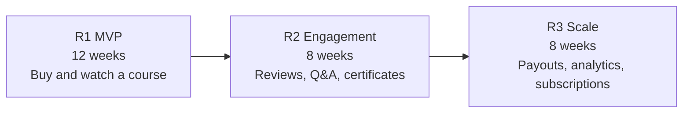
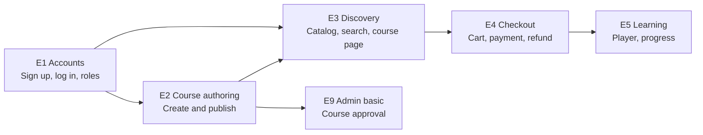
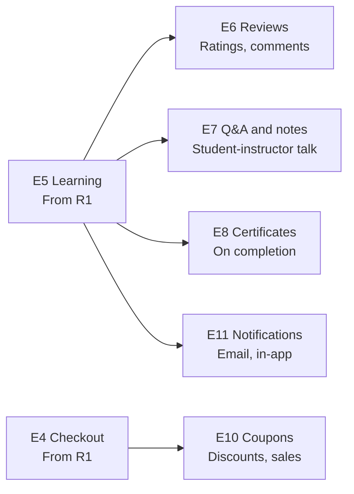
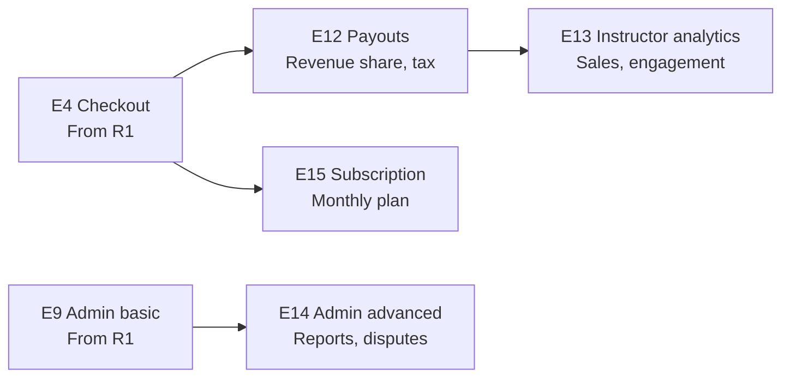
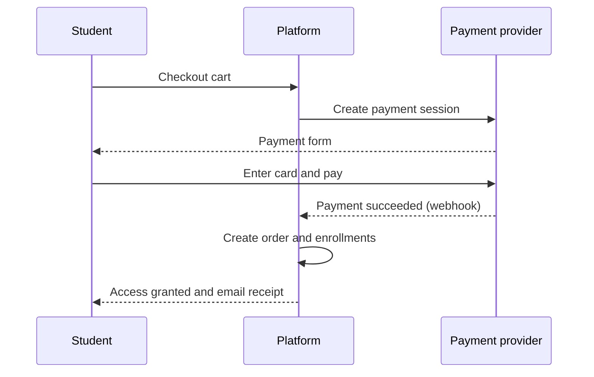
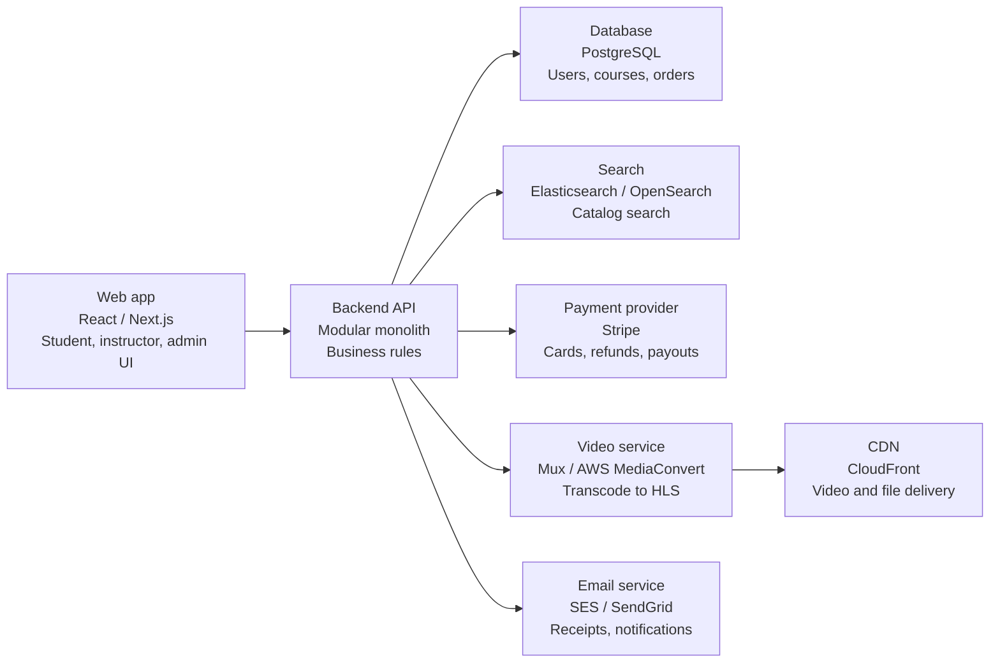

# Online Course Marketplace — Implementation Plan

| Item | Value |
|---|---|
| Document type | Business analysis: implementation plan and core user stories |
| Product | Online course marketplace (Udemy-style): instructors publish video courses, students buy and take them |
| Status | Draft v0.1 |
| Date | 2026-11-23 |

---

## 1. Summary

The platform connects two groups. Instructors create and sell video courses. Students find, buy, and complete courses. The platform takes a share of each sale.

The plan has three releases:

1. **Release 1 — MVP (about 12 weeks).** A student can find a course, pay, and watch it. An instructor can publish a course.
2. **Release 2 — Engagement (about 8 weeks).** Reviews, Q&A, certificates, coupons, notifications.
3. **Release 3 — Scale (about 8 weeks).** Instructor payouts, analytics, advanced moderation, subscriptions.

---

## 2. Goals and success metrics

| Goal | Metric | Target at 6 months after Release 1 |
|---|---|---|
| Students buy courses | Visit-to-purchase conversion | ≥ 2% |
| Students finish courses | Average course completion rate | ≥ 30% |
| Instructors publish | Published courses | ≥ 500 |
| Course quality | Average course rating | ≥ 4.2 / 5 |
| Platform is reliable | Video start time (p95) | < 2 seconds |

---

## 3. Personas

| Persona | Need | Main pain |
|---|---|---|
| **Student** | Learn a practical skill at low cost, at own pace | Too many courses, unclear quality |
| **Instructor** | Earn money from expert knowledge | Video hosting, payments, marketing are hard |
| **Admin** | Keep content legal and quality high | Manual review does not scale |
| **Finance operator** | Pay instructors correctly and on time | Refunds and taxes make payouts complex |

---

## 4. Scope

**In scope (Releases 1–3):** web application, video courses, one-time purchase, instructor revenue share, reviews, Q&A, certificates, coupons, admin moderation.

**Out of scope (later):** native mobile apps, live classes, business plan for companies, AI course recommendations, multi-language subtitles generated by machine.

---

## 5. Release overview

### Level 1 — Releases and epics

### Level 2 — Epics per release

---

## 6. Core user stories

Format: *As a [persona], I want [action], so that [benefit].*
Priority uses MoSCoW: **M** = Must, **S** = Should, **C** = Could.
Size uses story points (1, 2, 3, 5, 8, 13).

### E1 — Accounts and identity (R1)

| ID | User story | Priority | Size |
|---|---|---|---|
| US-1.1 | As a visitor, I want to sign up with email and password, so that I can buy courses. | M | 3 |
| US-1.2 | As a visitor, I want to sign up with Google, so that I do not create a new password. | S | 3 |
| US-1.3 | As a user, I want to log in and log out, so that my account stays secure. | M | 2 |
| US-1.4 | As a user, I want to reset my forgotten password, so that I do not lose access. | M | 2 |
| US-1.5 | As a student, I want to become an instructor from my account, so that I can teach without a second account. | M | 3 |
| US-1.6 | As a user, I want to edit my profile (name, photo, bio), so that others see who I am. | S | 2 |
| US-1.7 | As a user, I want to delete my account and data, so that my privacy rights (GDPR) are respected. | M | 3 |

**Acceptance criteria — US-1.1**
- Given a new email, when I submit the form with a password of 8+ characters, then the system creates the account and sends a verification email.
- Given an email that already exists, when I submit, then the system shows "Email already registered".
- Given an unverified account, when I try to buy, then the system asks me to verify my email first.

**Acceptance criteria — US-1.5**
- Given a logged-in student, when I accept the instructor terms, then my account gets the instructor role.
- Given the instructor role, when I open the menu, then I see "Instructor dashboard".

### E2 — Course authoring (R1)

| ID | User story | Priority | Size |
|---|---|---|---|
| US-2.1 | As an instructor, I want to create a draft course with title, subtitle, category, language, and level, so that I can start building it. | M | 3 |
| US-2.2 | As an instructor, I want to add sections and lectures and change their order, so that the course has a clear structure. | M | 5 |
| US-2.3 | As an instructor, I want to upload video lectures, so that students can watch them. | M | 8 |
| US-2.4 | As an instructor, I want to attach files (PDF, code) to a lecture, so that students get extra material. | S | 3 |
| US-2.5 | As an instructor, I want to mark some lectures as free preview, so that visitors can try the course. | M | 2 |
| US-2.6 | As an instructor, I want to set the course price from a fixed price list, so that I control my income. | M | 2 |
| US-2.7 | As an instructor, I want to add a course image, promo video, description, and learning goals, so that the course page sells the course. | M | 3 |
| US-2.8 | As an instructor, I want to submit the course for review, so that it can be published. | M | 3 |
| US-2.9 | As an instructor, I want to add a quiz to a section, so that students can check their knowledge. | C | 5 |

**Acceptance criteria — US-2.3**
- Given a video file (MP4, MOV, max 4 GB), when I upload it, then I see a progress bar and can continue to edit other lectures.
- Given an upload is complete, when processing ends, then the system shows the duration and the lecture status "Ready".
- Given a file in a wrong format, when I upload it, then the system rejects it and names the allowed formats.
- The system stores video in adaptive streaming format (HLS) and does not expose a direct download link.

**Acceptance criteria — US-2.8**
- Given a draft with fewer than 5 lectures or less than 30 minutes of video, when I submit, then the system blocks the submission and lists the missing items.
- Given a complete draft, when I submit, then status changes to "In review" and I cannot edit published fields.

### E3 — Course discovery (R1)

| ID | User story | Priority | Size |
|---|---|---|---|
| US-3.1 | As a visitor, I want to search courses by keyword, so that I find a topic fast. | M | 5 |
| US-3.2 | As a visitor, I want to filter results by category, price, level, language, rating, and duration, so that I narrow the list. | M | 5 |
| US-3.3 | As a visitor, I want to sort results by relevance, rating, newest, and price, so that I see the best match first. | S | 2 |
| US-3.4 | As a visitor, I want to browse courses by category, so that I can explore topics. | M | 3 |
| US-3.5 | As a visitor, I want to see a course page with curriculum, instructor, price, rating, and preview lectures, so that I decide to buy. | M | 5 |
| US-3.6 | As a student, I want to add a course to a wishlist, so that I can buy it later. | S | 2 |

**Acceptance criteria — US-3.1**
- Given the keyword "python", when I search, then the results contain courses with "python" in title, subtitle, or tags.
- Given a spelling mistake ("pyhton"), when I search, then the system still returns Python courses.
- Search returns results in less than 500 ms (p95).
- Only published courses appear.

### E4 — Cart, checkout, and refund (R1)

| ID | User story | Priority | Size |
|---|---|---|---|
| US-4.1 | As a student, I want to add courses to a cart, so that I can buy several at once. | M | 3 |
| US-4.2 | As a student, I want to pay by card through a secure payment provider, so that I get access immediately. | M | 8 |
| US-4.3 | As a student, I want to receive a receipt by email, so that I have proof of purchase. | M | 2 |
| US-4.4 | As a student, I want to see prices in my local currency, so that I understand the cost. | S | 5 |
| US-4.5 | As a student, I want to request a refund within 30 days, so that I am not at risk if the course is bad. | M | 5 |
| US-4.6 | As a student, I want to see my purchase history, so that I can track my spending. | S | 2 |

**Acceptance criteria — US-4.2**
- Given a cart with courses, when payment succeeds, then the system enrolls me in each course within 5 seconds and empties the cart.
- Given payment fails, when the provider returns an error, then the system shows the reason and keeps the cart.
- Given I already own a course, when I add it to the cart, then the system blocks it and shows "Already enrolled".
- The platform does not store card numbers (PCI DSS scope stays with the payment provider).

**Acceptance criteria — US-4.5**
- Given a purchase less than 30 days old and less than 30% of the course watched, when I request a refund, then the system refunds the full amount and removes access.
- Given a purchase older than 30 days, when I request a refund, then the system refuses and states the reason.

**Purchase flow**

### E5 — Learning experience (R1)

| ID | User story | Priority | Size |
|---|---|---|---|
| US-5.1 | As a student, I want to see "My learning" with all my courses, so that I can continue fast. | M | 3 |
| US-5.2 | As a student, I want to watch lectures in a video player with speed control and quality selection, so that I learn at my pace. | M | 8 |
| US-5.3 | As a student, I want the player to resume where I stopped, so that I do not search for my position. | M | 3 |
| US-5.4 | As a student, I want the system to mark lectures complete and show my course progress in %, so that I see my advance. | M | 3 |
| US-5.5 | As a student, I want to download lecture attachments, so that I can use them offline. | S | 2 |
| US-5.6 | As a student, I want lifetime access to a course I bought, so that I can return to it at any time. | M | 1 |

**Acceptance criteria — US-5.4**
- Given I watched 90% or more of a video lecture, then the system marks it complete.
- Given I complete a lecture, then course progress updates immediately on "My learning".
- Given I am not enrolled, when I open a non-preview lecture URL, then the system denies access.

### E6 — Reviews and ratings (R2)

| ID | User story | Priority | Size |
|---|---|---|---|
| US-6.1 | As a student, I want to rate a course 1–5 stars and write a review, so that others know its quality. | M | 3 |
| US-6.2 | As a visitor, I want to see the average rating and reviews on the course page, so that I trust my choice. | M | 2 |
| US-6.3 | As an instructor, I want to reply to a review, so that I can answer feedback. | S | 2 |
| US-6.4 | As a user, I want to report an abusive review, so that an admin removes it. | S | 2 |

**Acceptance criteria — US-6.1**
- Only enrolled students can rate. One rating per student per course; the student can edit it.
- The rating form appears after the student completes 10% of the course.

### E7 — Q&A and notes (R2)

| ID | User story | Priority | Size |
|---|---|---|---|
| US-7.1 | As a student, I want to ask a question on a lecture, so that I get help. | M | 5 |
| US-7.2 | As an instructor, I want to see and answer unanswered questions in one list, so that I support students fast. | M | 3 |
| US-7.3 | As a student, I want to take time-stamped notes on a video, so that I can review key points. | S | 3 |
| US-7.4 | As an instructor, I want to send an announcement to all my students, so that I share updates. | C | 3 |

### E8 — Certificates (R2)

| ID | User story | Priority | Size |
|---|---|---|---|
| US-8.1 | As a student, I want a certificate of completion when I reach 100%, so that I prove my learning. | M | 3 |
| US-8.2 | As an employer, I want to check a certificate by a public URL, so that I know it is real. | S | 2 |

### E10 — Coupons and promotions (R2)

| ID | User story | Priority | Size |
|---|---|---|---|
| US-10.1 | As an instructor, I want to create a coupon code with a discount, a limit, and an end date, so that I promote my course. | M | 5 |
| US-10.2 | As a student, I want to apply a coupon at checkout, so that I pay less. | M | 2 |
| US-10.3 | As an admin, I want to run a platform-wide sale, so that sales increase during events. | S | 5 |

### E11 — Notifications (R2)

| ID | User story | Priority | Size |
|---|---|---|---|
| US-11.1 | As a user, I want email and in-app notifications for answers, reviews, and purchases, so that I do not miss events. | M | 5 |
| US-11.2 | As a user, I want to choose which notifications I get, so that I am not spammed. | S | 2 |

### E12 — Instructor payouts (R3)

| ID | User story | Priority | Size |
|---|---|---|---|
| US-12.1 | As an instructor, I want to register my payout method and tax data, so that I get paid legally. | M | 5 |
| US-12.2 | As an instructor, I want a monthly payout of my revenue share after the refund period, so that I receive my income. | M | 8 |
| US-12.3 | As a finance operator, I want a payout report per instructor, so that I can audit payments. | M | 3 |

**Acceptance criteria — US-12.2**
- Revenue share: the system applies the configured split per sale (example: 63% instructor / 37% platform; the business must confirm the value).
- The system pays only for sales older than 30 days (after the refund period).
- The system does not pay a balance below the minimum threshold (example: 50 USD); it carries the balance to the next month.

### E13 — Instructor analytics (R3)

| ID | User story | Priority | Size |
|---|---|---|---|
| US-13.1 | As an instructor, I want to see revenue, enrollments, and ratings per course over time, so that I know what works. | M | 5 |
| US-13.2 | As an instructor, I want to see where students stop watching, so that I improve weak lectures. | S | 5 |

### E9 and E14 — Administration (R1 basic, R3 advanced)

| ID | User story | Priority | Release | Size |
|---|---|---|---|---|
| US-9.1 | As an admin, I want to approve or reject a submitted course with a reason, so that only quality content is published. | M | R1 | 5 |
| US-9.2 | As an admin, I want to manage categories, so that the catalog stays organized. | M | R1 | 2 |
| US-9.3 | As an admin, I want to suspend a user or unpublish a course, so that I stop abuse. | M | R1 | 3 |
| US-14.1 | As an admin, I want a queue of user reports (reviews, Q&A, courses), so that I handle abuse in one place. | S | R3 | 5 |
| US-14.2 | As an admin, I want a dashboard of sales, refunds, and active users, so that I monitor the business. | S | R3 | 5 |

### E15 — Subscription (R3)

| ID | User story | Priority | Size |
|---|---|---|---|
| US-15.1 | As a student, I want a monthly subscription that gives access to a selected course collection, so that I learn many topics for one price. | C | 13 |

---

## 7. Non-functional requirements

| Area | Requirement |
|---|---|
| Performance | Page load < 2.5 s (LCP, p75). Video start < 2 s (p95). Search < 500 ms (p95). |
| Availability | 99.9% monthly for catalog, checkout, and player. |
| Scale | Release 1 supports 10,000 concurrent viewers. |
| Security | OWASP Top 10 controls. Passwords hashed (bcrypt/argon2). HTTPS only. Signed, short-lived video URLs. |
| Privacy | GDPR: consent, data export, data deletion. |
| Payments | PCI DSS handled by the payment provider. No card data on platform servers. |
| Accessibility | WCAG 2.2 AA. Captions supported in the player. |
| Content protection | DRM is not in Release 1. Signed URLs and HLS reduce casual download. |

---

## 8. Proposed architecture (high level)

Recommendation: start with a modular monolith. Split into services only when a module needs independent scale (video and search first).

---

## 9. Delivery plan

### Release 1 — MVP (12 weeks, 6 sprints of 2 weeks)

| Sprint | Content | Exit check |
|---|---|---|
| S1 | Project setup, CI/CD, E1 accounts (US-1.1 – 1.5) | A user can sign up, log in, become instructor |
| S2 | E2 course draft, sections, lectures (US-2.1, 2.2, 2.6, 2.7) | An instructor builds a course outline |
| S3 | E2 video upload and processing (US-2.3, 2.5) | An uploaded video plays as HLS |
| S4 | E3 catalog, search, course page (US-3.1 – 3.5) | A visitor finds a course and sees the course page |
| S5 | E4 cart, payment, receipt, refund (US-4.1 – 4.3, 4.5) | A student pays and gets access |
| S6 | E5 player, progress; E9 admin approval (US-5.x, 9.1 – 9.3); hardening | End-to-end flow passes; security and load test pass |

### Release 2 — Engagement (8 weeks)

E6 reviews → E7 Q&A and notes → E8 certificates → E10 coupons → E11 notifications.

### Release 3 — Scale (8 weeks)

E12 payouts → E13 analytics → E14 admin advanced → E15 subscription (if business case is approved).

### Team (suggested)

1 product owner, 1 business analyst, 1 UX designer, 3 full-stack developers, 1 QA engineer, 0.5 DevOps engineer.

---

## 10. Risks

| Risk | Impact | Mitigation |
|---|---|---|
| Video costs (storage, transcoding, CDN) grow fast | High | Use a managed video service with clear per-minute pricing. Set upload size limits. Monitor cost per course. |
| Course piracy | Medium | Signed URLs, HLS, watermark later; DRM in a later release. |
| Low-quality or copied content | High | Admin review before publish. Report function. |
| Payment fraud and chargebacks | Medium | Provider fraud tools. Refund policy limits (30%-watched rule). |
| Tax rules per country (VAT) | High | Use a provider with tax calculation (for example Stripe Tax). Confirm with a tax advisor. |
| Empty marketplace at launch | High | Recruit 50+ instructors before launch. |

---

## 11. Open questions for the business

1. What is the revenue split between instructor and platform? Is it different for sales from instructor coupons?
2. Which countries and currencies are in Release 1?
3. Is the 30-day refund rule with the 30%-watched limit accepted?
4. Is course approval manual for every course, or only for new instructors?
5. Is the subscription model (E15) part of the business plan, or only a later option?
6. Which payment provider is preferred (Stripe, Adyen, PayPal)?

---

## 12. Definition of Done (each story)

- Acceptance criteria pass in a test environment.
- Unit and integration tests written and passing.
- Code reviewed by one other developer.
- Accessibility check passes (WCAG 2.2 AA).
- Product owner accepts the story in a demo.
