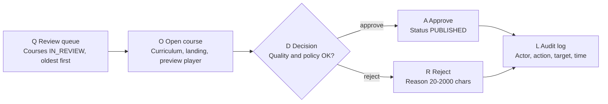

# Spec: admin — V1

Status: proposed · Module id: `admin` · Release: R1 · Depends on: `authoring`, `identity`

Inherits Code Style, Testing Strategy, and Boundaries from [SPEC-platform.md](SPEC-platform.md).

## Objective

Let an admin keep content legal and quality high: approve or reject submitted courses, manage categories, suspend users, and unpublish courses. Record every admin action in an audit log.

Stories: US-9.1, US-9.2, US-9.3.

## Design

`admin` has no course or user data of its own. It calls the public APIs of `authoring` and `identity`, and it owns only the audit log and review notes.

| Kind | Name |
|---|---|
| Port in | `ReviewCourseUseCase`, `ManageCategoriesUseCase`, `SuspendUserUseCase`, `ModerateCourseUseCase`, `QueryAuditLogUseCase` |
| Port out | `CourseReviewPort` (→ `authoring.api.CourseReviewApi`), `CategoryAdminPort` (→ `authoring.api.CategoryAdminApi`), `UserModerationPort` (→ `identity` `SuspendUserUseCase`), `AuditLogRepository` |
| Adapter out | JPA (schema `admin`), structured log stream `audit` to Loki |

### Review decision

The instructor sees the rejection reason on the submit page (`authoring`). Email notice is in R2 `notification`.

## REST API (role `admin`; token must have `acr` showing OTP was used)

| Method | Path | Purpose |
|---|---|---|
| GET | `/api/v1/admin/review-queue?page&size` | Courses `IN_REVIEW` with submit time, instructor |
| GET | `/api/v1/admin/courses/{id}` | Full course for review (any status) |
| POST | `/api/v1/admin/courses/{id}/approval` | Approve |
| POST | `/api/v1/admin/courses/{id}/rejection` | Reject with `{ "reason": "…" }` |
| POST | `/api/v1/admin/courses/{id}/unpublication` | Unpublish with reason (US-9.3) |
| POST | `/api/v1/admin/courses/{id}/restoration` | Restore an unpublished course |
| GET / POST / PUT / DELETE | `/api/v1/admin/categories[/{id}]` | Category CRUD (US-9.2). Delete only if no course uses it. Max depth 2. |
| POST | `/api/v1/admin/users/{userId}/suspension` | Suspend with reason (US-9.3): Keycloak user disabled, sessions ended, `UserSuspended` published |
| DELETE | `/api/v1/admin/users/{userId}/suspension` | Lift suspension |
| GET | `/api/v1/admin/audit-log?actor&action&from&to&page` | Audit search |

All write calls are idempotent: approving an already published course returns 409 with the current status.

## Audit log

Table `admin.audit_entry` (append-only; the application database user has `INSERT` and `SELECT` only): id, actorId, action, targetType, targetId, reason, traceId, occurredAt. Each entry is also written as one JSON line to the `audit` log stream (Loki retention 1 year).

Login and role events from Keycloak go to the same Loki stream through Alloy.

## Frontend (`features/admin`)

| Route | Page |
|---|---|
| `/admin/review` | Queue (MUI DataGrid) |
| `/admin/review/:courseId` | Course review with player for each lecture, approve and reject dialog |
| `/admin/categories` | Category tree editor |
| `/admin/users` | Find user by id or email (via `identity`), suspend dialog |
| `/admin/audit` | Audit log table with filters |

## Testing

- Service: `reject_reasonTooShort_throwsRuleViolation`, `approve_anyAction_writesAuditEntry` with `FakeCourseReviewPort`, `FakeAuditLogRepository`.
- Security: every `/api/v1/admin/**` endpoint returns 403 for `instructor` and for an admin token without OTP (`acr`). Test is generated from the endpoint list.
- Module: `approve_courseInReview_courseAppearsInSearch` (admin → authoring → catalog).
- DB: `auditEntry_updateStatement_isDenied` (Testcontainers PostgreSQL with the real grants).

## Success Criteria

1. An admin approves a submitted course; it appears in search within 5 s.
2. An admin rejects with a reason; the instructor sees the reason and can edit and resubmit.
3. A suspended user cannot log in and their active session ends within 1 minute.
4. An unpublished course is gone from search and the course page returns 404; enrolled students still open it in "My learning".
5. Every action in this spec creates one audit entry with actor, target, reason, and trace id; audit rows cannot be updated or deleted by the application.
6. Category in use cannot be deleted (409 with the number of courses).

## Out of Scope (Deferred)

- Report queue for reviews, Q&A, courses (US-14.1) — R3 delta spec on `admin`.
- Business dashboard (US-14.2) — R3 `analytics`.
- Approval only for new instructors (plan open question 4) — after the business decides.

## Open Questions

1. Is manual approval required for every course, or only for new instructors? (Plan §11 question 4.)
