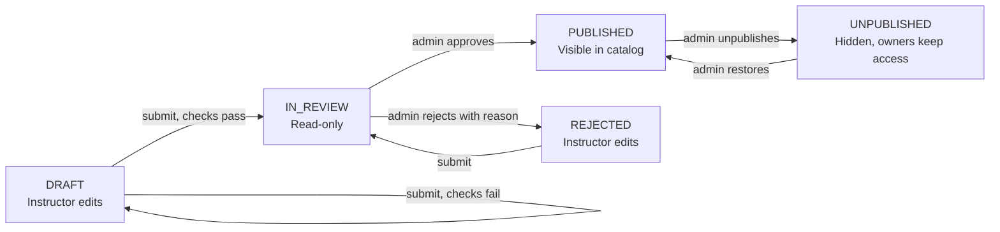

# Spec: authoring — V1

Status: proposed · Module id: `authoring` · Release: R1 · Depends on: `identity`

Inherits Code Style, Testing Strategy, and Boundaries from [SPEC-platform.md](SPEC-platform.md). Reference implementation: [architecture.md §9](../docs/architecture.md).

## Objective

Let an instructor build a course (structure, details, price) and submit it for review. This module owns the `Course` aggregate, its status, and the category list. It is the first full Hexagonal vertical slice and the reference for all other modules.

Stories: US-2.1, 2.2, 2.5, 2.6, 2.7, 2.8. Video and attachments (US-2.3, 2.4) are in `media`; `authoring` keeps the lecture status that `media` reports.

## Domain model

| Object | Fields and rules |
|---|---|
| `Course` (aggregate) | id, instructorId, slug, details (title 1–120, subtitle ≤ 200, categoryId, language ISO 639-1, level `BEGINNER | INTERMEDIATE | EXPERT | ALL`), price (`PriceTier`), landing (imageKey, promoLectureId, description 200–5000 chars, learningGoals 4–10 items of ≤ 160), status, rejectionReason, version |
| `Section` | id, title 1–80, position. Belongs to one course. |
| `Lecture` | id, title 1–80, position, freePreview flag, videoStatus `NONE | PROCESSING | READY | FAILED`, durationSeconds |
| `PriceTier` | 0, 19.99, 29.99, 49.99, 99.99, 199.99 USD |
| `Category` | id, name, parentId. Managed by `admin` through `CategoryAdminApi`. |

Rules:
- Only the owner instructor changes a course.
- Structure and details change only in `DRAFT` or `REJECTED`.
- At most 5 free preview lectures per course.
- `slug` is created from the title at first submit and does not change after publish.

### Status

Submit checks (US-2.8): ≥ 5 lectures, all lectures `READY`, total video ≥ 30 min, image set, description and 4+ learning goals set, price set. The response lists every missing item.

Editing a published course (new version workflow) is deferred.

## Ports and adapters

| Kind | Name |
|---|---|
| Port in | `CreateCourseUseCase`, `GetCourseUseCase`, `UpdateCourseUseCase`, `DeleteCourseUseCase`, `ManageCurriculumUseCase`, `UpdateLandingPageUseCase`, `SubmitCourseUseCase` |
| Port in (public, `authoring.api`) | `CourseReviewApi` (approve, reject, unpublish, restore — for `admin`), `CategoryAdminApi` (for `admin`), `PublishedCourseQuery` (snapshot + curriculum — for `catalog`, `learning`) |
| Port out | `CourseRepository`, `CategoryRepository`, `CourseEventPublisher`, `CourseImageStoragePort` |
| Adapter in | REST controllers; `VideoStatusListener` (consumes `media.video.v1`) |
| Adapter out | JPA (schema `authoring`), Spring Modulith outbox → Kafka, S3 presigned upload for course image |

## REST API (role `instructor`, owner only)

| Method | Path | Purpose |
|---|---|---|
| POST | `/api/v1/courses` | Create draft (US-2.1) → 201 + `Location` |
| GET | `/api/v1/courses?page&size` | List my courses |
| GET | `/api/v1/courses/{id}` | Course with curriculum |
| PUT | `/api/v1/courses/{id}` | Update details and price (US-2.1, 2.6) |
| DELETE | `/api/v1/courses/{id}` | Delete draft → 204. Not allowed after first publish. |
| POST | `/api/v1/courses/{id}/sections` | Add section |
| PUT / DELETE | `/api/v1/courses/{id}/sections/{sectionId}` | Rename / delete (only if empty) |
| POST | `/api/v1/courses/{id}/sections/{sectionId}/lectures` | Add lecture |
| PUT / DELETE | `/api/v1/courses/{id}/lectures/{lectureId}` | Rename, set free preview / delete |
| PUT | `/api/v1/courses/{id}/curriculum-order` | Full order of sections and lectures in one call (US-2.2) |
| PUT | `/api/v1/courses/{id}/landing` | Description, goals, promo lecture (US-2.7) |
| POST | `/api/v1/courses/{id}/image-upload` | Presigned PUT, JPEG/PNG/WebP ≤ 5 MB, min 750×422 |
| POST | `/api/v1/courses/{id}/submission` | Submit (US-2.8) → 202, or 422 with missing items |
| GET | `/api/v1/categories` | Public category tree |
| GET | `/api/v1/price-tiers` | Public price list |

Concurrency: `PUT` requests send `If-Match: <version>`. A stale version returns 412.

## Events (`authoring.course.v1`, key = courseId)

| Event | Payload |
|---|---|
| `CourseChangedEvent` | courseId, changeType `CREATED | UPDATED | DELETED | SUBMITTED | PUBLISHED | REJECTED | UNPUBLISHED | RESTORED`, occurredAt |

Consumers call `PublishedCourseQuery` for full data. The event stays small.

## Frontend (`features/authoring`)

| Route | Page |
|---|---|
| `/instructor/courses` | MUI DataGrid of my courses with status chips |
| `/instructor/courses/new` | Create form |
| `/instructor/courses/:id/curriculum` | Sections and lectures, drag and drop order (`@dnd-kit`), keyboard reorder for accessibility |
| `/instructor/courses/:id/details` | Details and price |
| `/instructor/courses/:id/landing` | Image, description, goals, promo |
| `/instructor/courses/:id/submit` | Checklist of submit checks, submit button |

## Testing

- Domain: `submit_fourLectures_returnsMissingItemLectureCount`, `updateDetails_courseInReview_throwsRuleViolation`, `setFreePreview_sixthPreview_throwsRuleViolation`, `reorder_unknownLectureId_throwsRuleViolation`.
- Service: `delete_notOwner_throwsAccessDenied` with `FakeCourseRepository`, `FakeCourseEventPublisher`.
- Web: `create_invalidTitle_returns400`, `update_staleVersion_returns412`.
- Module: `approve_courseInReview_publishesCoursePublished` (Modulith `Scenario`).
- E2E: instructor creates a course, adds 2 sections and 5 lectures, reorders, saves details.

## Success Criteria

1. An instructor completes the CRUD cycle for a draft course through the UI; every change persists after a page reload.
2. A student calling `POST /api/v1/courses` gets 403. Instructor B reading instructor A's course gets 404.
3. Submit with 4 lectures returns 422 and lists "Add 1 more lecture" and any other missing item.
4. Submit of a complete course sets `IN_REVIEW`; a later `PUT` returns 409 with the current status in the message.
5. Each status change produces exactly one Kafka record on `authoring.course.v1` (verified even when Kafka is down during the change and starts later).
6. Concurrent edit with an old `If-Match` returns 412.
7. ArchUnit: `authoring.domain` has no dependency on Spring, JPA, or Kafka.

## Out of Scope (Deferred)

- Quiz (US-2.9, priority C) — R2.
- Editing a published course with a second version and re-review — R2.
- Co-instructors — not planned.

## Open Questions

1. Is the minimum 5 lectures / 30 minutes rule confirmed by the business?
2. Can an instructor delete a published course with students? Assumed: no; only admin can unpublish.
