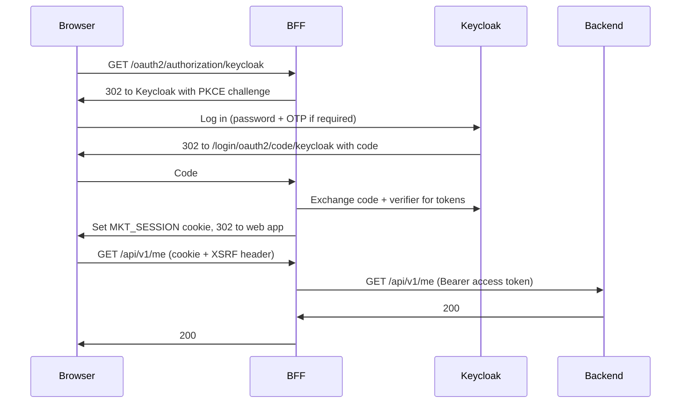
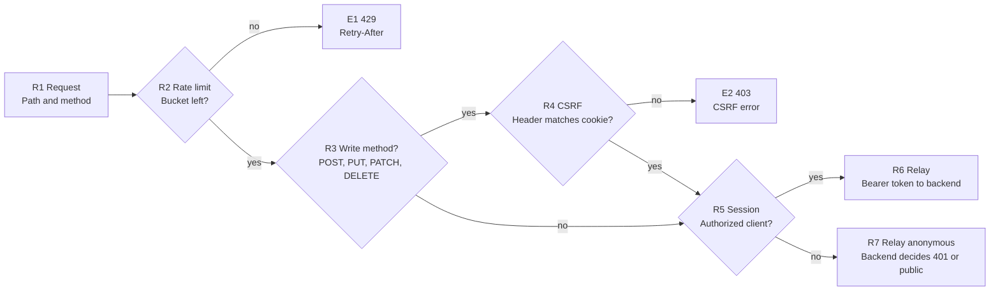

# Spec: bff-gateway — V1

Status: proposed · Module id: `bff-gateway` · Release: R1 · Depends on: `identity`

Inherits Code Style, Testing Strategy, and Boundaries from [SPEC-platform.md](SPEC-platform.md).

## Objective

Be the only entry point for the browser. Keep OAuth tokens on the server. The browser holds only an `HttpOnly` session cookie (ADR-007, OAuth 2.0 for Browser-Based Apps BCP). Apply edge controls: CSRF, rate limits, security headers.

## Design

Maven module `bff-gateway` in `backend/bff-gateway`. Spring Cloud Gateway Server Web MVC + `spring-boot-starter-oauth2-client` + Spring Session with Valkey.

| Concern | Decision |
|---|---|
| Login | `GET /oauth2/authorization/keycloak` → Authorization Code + PKCE with Keycloak client `bff-gateway` |
| Session | Spring Session in Valkey. Cookie `MKT_SESSION`: `HttpOnly`, `Secure` (except localhost), `SameSite=Lax`, path `/` |
| Token storage | `OAuth2AuthorizedClient` in the session. Refresh is automatic when the access token has < 30 s left. |
| Token relay | Route `/api/**` → `http://backend:8090` with the `TokenRelay` filter. Strip the `Cookie` header before relay. |
| Role refresh | After `POST /api/v1/me/instructor-role` returns 2xx, the BFF forces a token refresh. |
| Logout | `POST /logout` → end session, then RP-initiated logout at Keycloak, redirect to `/` |
| CSRF | Cookie `XSRF-TOKEN` (readable by JS), header `X-XSRF-TOKEN` required on POST, PUT, PATCH, DELETE |
| Webhooks | `/api/v1/webhooks/**` bypasses session and CSRF; backend checks the provider signature |
| Rate limits (Bucket4j + Valkey) | Login start 10/min per IP. API 300/min per session. Search 60/min per IP. → 429 + `Retry-After` |
| Security headers | CSP `default-src 'self'; media-src 'self' blob: http://localhost:9000; frame-ancestors 'none'`, HSTS (non-local), `X-Content-Type-Options: nosniff`, `Referrer-Policy: strict-origin-when-cross-origin` |
| Static web | Locally Vite proxies to the BFF. Later the BFF serves the built web app. |

### Session endpoint

`GET /bff/session` → 200

```json
{ "authenticated": true, "userId": "…", "displayName": "Ana", "roles": ["student", "instructor"], "emailVerified": true }
```

Anonymous → `{ "authenticated": false }`. The web app calls it on load. It never returns a token.

### Login flow



### Request decision



## Backend side (resource server)

The backend validates the JWT (issuer `http://keycloak:8180/realms/marketplace`, audience `marketplace-api`) and maps `realm_access.roles` to `ROLE_*` authorities. The backend accepts traffic only from the BFF network (Compose network `internal`).

## Frontend

- `shared/auth/useSession()` hook reads `/bff/session` with TanStack Query.
- `apiFetch` adds `X-XSRF-TOKEN` from the cookie and `credentials: "include"`. Orval uses it as the custom fetcher.
- On 401 the app redirects to `/oauth2/authorization/keycloak`.

## Testing

- Web slice: `relay_withSession_addsBearerHeader`, `post_withoutCsrfHeader_returns403`, `session_anonymous_returnsAuthenticatedFalse`.
- IT with Keycloak + Valkey Testcontainers: full login with a test user (HtmlUnit or Playwright), then `/api/v1/me` returns 200.
- Security: no response body or header from the BFF contains `access_token`, `refresh_token`, or `id_token` (assert in E2E with network capture).

## Boundaries (deltas)

- **Never:** return a token to the browser. Store tokens in `localStorage` or `sessionStorage`.
- **Ask first:** relax CSP or the cookie `SameSite` value.

## Success Criteria

1. Log in through the web app works; browser storage holds no token; the only auth cookie is `MKT_SESSION` with `HttpOnly`.
2. A `PUT /api/v1/me` without `X-XSRF-TOKEN` returns 403.
3. 11 login starts from one IP in one minute → the 11th returns 429.
4. After 30 min idle the session ends; the next API call returns 401.
5. After "Become instructor" the next `/bff/session` lists `instructor` without a new login.
6. Logout ends the BFF session and the Keycloak SSO session.
7. One trace spans browser request → BFF → backend in Tempo.

## Out of Scope (Deferred)

- Serving the production web build from the BFF — with Kubernetes.
- Device or session management page ("log out other devices") — R2.

## Open Questions

None.
