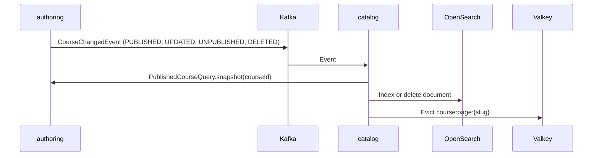

# Spec: catalog — V1

Status: proposed · Module id: `catalog` · Release: R1 · Depends on: `authoring`

Inherits Code Style, Testing Strategy, and Boundaries from [SPEC-platform.md](SPEC-platform.md).

## Objective

Let a visitor find a course and decide to buy it: keyword search with typo tolerance, filters, sort, category browse, and a fast course page. Let a student keep a wishlist.

Stories: US-3.1 – US-3.6.

## Read model

`catalog` keeps its own read model. It never writes course data.

Only `PUBLISHED` courses are in the index (US-3.1 rule). `UNPUBLISHED` and `DELETED` remove the document.

### Index `courses-v1` (alias `courses`)

| Field | Type | Use |
|---|---|---|
| title | text (`english` analyzer) + `search_as_you_type` | Search, boost 3 |
| subtitle | text | Search, boost 2 |
| tags, learningGoals | text | Search, boost 1 |
| instructorName | text | Search, boost 1 |
| categoryPath | keyword[] | Filter, browse |
| level, language | keyword | Filter |
| priceMinor | long | Filter (free, paid, ranges), sort |
| ratingAverage, ratingCount | float, integer | Filter (≥ 3.5, ≥ 4.0, ≥ 4.5), sort. 0 until R2. |
| durationSeconds | integer | Filter buckets: 0–1 h, 1–3 h, 3–6 h, 6–17 h, 17+ h |
| publishedAt | date | Sort "newest" |
| slug, imageKey | keyword | Display |

Search query: `multi_match` with `fuzziness: AUTO` (US-3.1 "pyhton"), filters in `bool.filter`, aggregations for facet counts. Reindex: create `courses-v2`, fill, switch the alias.

## Ports and adapters

| Kind | Name |
|---|---|
| Port in | `SearchCoursesUseCase`, `BrowseCategoryUseCase`, `GetCoursePageUseCase`, `ManageWishlistUseCase` |
| Port in (public, `catalog.api`) | `CoursePriceQuery` (current price + published flag — for `checkout`) |
| Port out | `CourseSearchIndex`, `CoursePageCache`, `PublishedCourseSource`, `WishlistRepository` |
| Adapter in | REST; `CourseIndexListener` (`@ApplicationModuleListener`) |
| Adapter out | OpenSearch Java client, Valkey (Spring Data Redis), `authoring` API, JPA (schema `catalog`) |

## REST API

| Method | Path | Role | Result |
|---|---|---|---|
| GET | `/api/v1/catalog/search?q&category&level&language&price&rating&duration&sort&page&size` | public | Results + facet counts. `sort`: `relevance` (default), `rating`, `newest`, `price_asc`, `price_desc`. `size` ≤ 50. |
| GET | `/api/v1/catalog/categories/{slug}` | public | Category page: top-rated, newest, subcategories |
| GET | `/api/v1/catalog/courses/{slug}` | public | Course page: details, curriculum (titles, durations, preview flags), instructor, price, rating |
| GET | `/api/v1/catalog/suggest?q` | public | Max 8 title suggestions |
| GET / PUT / DELETE | `/api/v1/wishlist`, `/api/v1/wishlist/{courseId}` | user | Wishlist (US-3.6) |

Course page cache: Valkey key `course:page:{slug}`, TTL 10 min, evicted on events. Response header `Cache-Control: public, max-age=60`.

## Frontend (`features/catalog`)

| Route | Page |
|---|---|
| `/` | Home: categories, newest courses |
| `/search?q=…` | Results list, filter drawer (MUI Drawer on mobile, side panel on desktop), sort select, pagination; URL holds all filters |
| `/category/:slug` | Category browse |
| `/course/:slug` | Course page: hero, "What you'll learn", curriculum accordion, preview button, instructor, price, "Add to cart", wishlist heart |

Header search box with suggestions (MUI Autocomplete, debounce 250 ms).

## Testing

- Unit: `buildQuery_ratingFilter4_addsRangeGte4`, `buildQuery_sortNewest_sortsByPublishedAtDesc`.
- IT (OpenSearch Testcontainer): `search_misspelledPyhton_returnsPythonCourse`, `search_unpublishedCourse_notReturned`, `facets_threeLevels_returnsCountPerLevel`.
- Module: `onCourseUnpublished_removesDocumentAndEvictsCache`.
- Load (k6, 10 000 seeded courses): search p95 < 500 ms at 100 requests/s.
- E2E: search "python" → filter level → open course page → add to wishlist.

## Success Criteria

1. Search "python" returns courses with "python" in title, subtitle, or tags; "pyhton" returns the same top 5.
2. Each filter and sort in the API table changes the results; facet counts match the result set.
3. A course published by an admin appears in search within 5 s; an unpublished course disappears within 5 s.
4. Search p95 < 500 ms and course page p95 < 300 ms (cache hit) in the k6 test.
5. The course page shows the curriculum, preview flags, instructor, price, and rating (0 shown as "No ratings yet").
6. Wishlist add, list, and remove work for a logged-in user; anonymous users are sent to login.
7. Filter drawer and results pass axe checks with no serious violations.

## Out of Scope (Deferred)

- Semantic (vector) search — R2 `ai-assistant`.
- Personalized recommendations — out of scope in the plan.
- Public instructor profile page — R2.

## Open Questions

1. Who manages course tags in R1? Assumed: the instructor enters up to 10 tags in `authoring` details. This adds a field to `SPEC-authoring.md` if confirmed.
