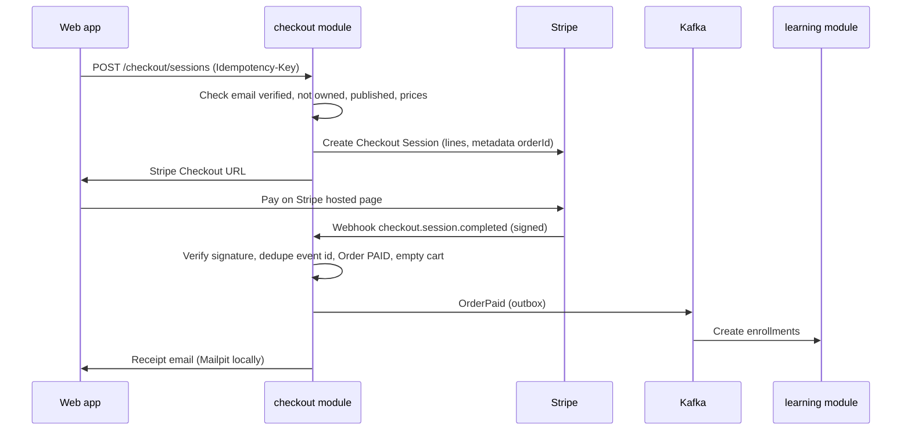
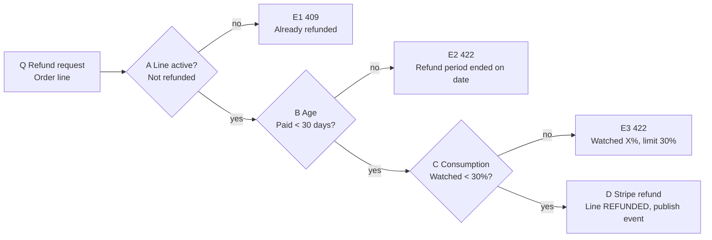

# Spec: checkout — V1

Status: proposed · Module id: `checkout` · Release: R1 · Depends on: `catalog`, `identity`

Inherits Code Style, Testing Strategy, and Boundaries from [SPEC-platform.md](SPEC-platform.md).

## Objective

Let a student buy one or more courses by card and get access immediately. Send a receipt. Allow a refund within 30 days if less than 30% is watched. The platform never touches card data (Stripe Checkout, PCI DSS SAQ A).

Stories: US-4.1, 4.2, 4.3, 4.5, 4.6. US-4.4 (local currency) is deferred.

## Domain

| Object | Fields and rules |
|---|---|
| `Cart` | userId, items (courseId, priceMinor at add time). Max 20 items. Stored in Valkey `cart:{userId}`, TTL 30 days. |
| `Order` | id, userId, status `PENDING | PAID | FAILED | EXPIRED`, lines, totalMinor, currency `USD`, stripeSessionId, paidAt |
| `OrderLine` | courseId, instructorId, priceMinor, status `ACTIVE | REFUNDED`, refundedAt |
| Ownership rule | A user owns a course if an `ACTIVE` line exists in a `PAID` order. |
| Refund rule | Line is `ACTIVE`, `paidAt` < 30 days ago, watched < 30% of the course. |

Price at checkout always comes from `catalog.api.CoursePriceQuery`, never from the browser or the cart.

### Refund eligibility (no dependency cycle)

`checkout.api` declares the interface `CourseConsumptionProvider { int watchedPercent(UUID userId, UUID courseId); }`. The `learning` module implements it. `checkout` depends only on its own interface; `learning` depends on `checkout`.

## Purchase flow

The success page polls `GET /api/v1/orders/{id}` until `PAID` (max 10 s), then links to "My learning".

## Ports and adapters

| Kind | Name |
|---|---|
| Port in | `ManageCartUseCase`, `StartCheckoutUseCase`, `ConfirmPaymentUseCase`, `RequestRefundUseCase`, `GetPurchaseHistoryUseCase` |
| Port in (public, `checkout.api`) | `OwnershipQuery` (for `learning`), events |
| Port out | `CartStore`, `OrderRepository`, `PaymentGatewayPort`, `ReceiptSenderPort`, `CoursePricePort`, `CourseConsumptionProvider`, `ProcessedWebhookRepository`, `CheckoutMetricsPort` |
| Adapter out | Valkey, JPA (schema `checkout`), Stripe Java SDK (Resilience4j circuit breaker + retry), SMTP (Spring Mail), Micrometer |

## REST API

| Method | Path | Role | Purpose |
|---|---|---|---|
| GET | `/api/v1/cart` | user | Cart with current prices |
| PUT | `/api/v1/cart/items/{courseId}` | user | Add (US-4.1). 409 "Already enrolled" if owned. |
| DELETE | `/api/v1/cart/items/{courseId}` | user | Remove |
| POST | `/api/v1/checkout/sessions` | user, email verified | Create Stripe session. Header `Idempotency-Key` required. 403 "Verify your email first" if not verified. |
| GET | `/api/v1/orders?page` | user | Purchase history (US-4.6) |
| GET | `/api/v1/orders/{id}` | owner | Order status |
| POST | `/api/v1/orders/{id}/lines/{courseId}/refund` | owner | Refund (US-4.5) |
| POST | `/api/v1/webhooks/stripe` | Stripe signature | Payment events |

## Events (`checkout.order.v1`, key = userId)

`OrderPaid(orderId, userId, lines[courseId, instructorId, priceMinor], paidAt)`, `OrderLineRefunded(orderId, userId, courseId, amountMinor, refundedAt)`.

## Refund decision

`learning` removes access on `OrderLineRefunded` (US-4.5).

## Security

- Webhook: verify `Stripe-Signature` with the endpoint secret and a 5 min tolerance. Store processed event ids (unique key) for idempotency.
- Amounts only from the server. Stripe metadata holds `orderId` only.
- Rate limit checkout creation: 10/min per user (BFF).
- Stripe secret key from `.env` locally; never in logs.

## Frontend (`features/checkout`)

| Route | Page |
|---|---|
| `/cart` | Cart list, total, "Checkout" button |
| `/checkout/success?order=…` | Waiting state, then success with links |
| `/checkout/cancel` | Back to cart; cart kept (US-4.2) |
| `/account/purchases` | History with refund button and eligibility text |

## Testing

- Domain: `refund_paid31DaysAgo_throwsRefundPeriodEnded`, `refund_watched30Percent_throwsConsumptionLimit`, `addItem_ownedCourse_throwsAlreadyEnrolled`.
- Service with `FakePaymentGateway`: `confirmPayment_sameEventTwice_createsOneOrder`.
- Adapter IT: `StripeWebhookIT_invalidSignature_returns400`.
- Contract: Stripe CLI `stripe listen --forward-to localhost:8080/api/v1/webhooks/stripe` in manual E2E; automated E2E uses Stripe test mode card `4242 4242 4242 4242`.
- Metrics: `marketplace.orders.paid`, `marketplace.payments.failed`, `marketplace.refunds` exist after the E2E run.

## Success Criteria

1. A verified student buys 2 courses in one checkout; both appear in "My learning" ≤ 5 s after Stripe confirms; the cart is empty (US-4.2).
2. A declined card (`4000 0000 0000 0002`) shows the Stripe reason; the cart is kept.
3. Adding an owned course returns "Already enrolled".
4. An unverified user gets "Verify your email first" at checkout.
5. The receipt email in Mailpit lists each course, price, total, and order id.
6. Refund at day 5 with 10% watched succeeds and access is removed; refund at day 31 or with 35% watched is refused with the reason.
7. The same webhook delivered 3 times creates one order and one `OrderPaid` event.
8. No card number appears in any database table, log, or trace.

## Out of Scope (Deferred)

- Local currency display (US-4.4) and tax calculation (Stripe Tax) — after the business answers plan question 2.
- Coupons — R2 `promotion`.
- Chargeback handling — R3 `admin` delta.

## Open Questions

1. Is the 30-day / 30% refund rule confirmed? (Plan §11 question 3.)
2. Is Stripe the chosen provider? (Plan §11 question 6.) The `PaymentGatewayPort` allows a change.
