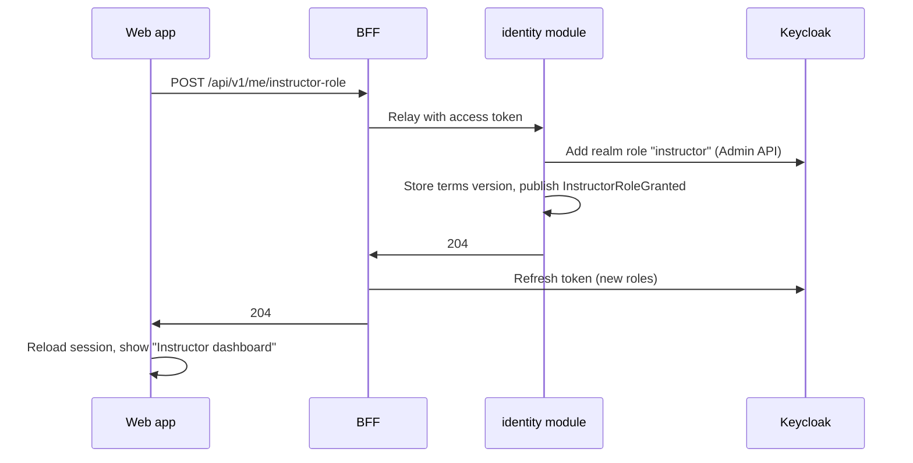

# Spec: identity — V1

Status: proposed · Module id: `identity` · Release: R1 · Depends on: `platform`

Inherits Code Style, Testing Strategy, and Boundaries from [SPEC-platform.md](SPEC-platform.md).

## Objective

Let a visitor create an account, log in, and manage it. Let a student become an instructor without a second account. Let a user delete the account (GDPR).

Keycloak owns credentials, login, email verification, password reset, and Google login. The `identity` module owns the user profile and the actions that change roles or delete accounts.

| Story | Owner |
|---|---|
| US-1.1 Sign up with email | Keycloak (registration enabled, email verification on) |
| US-1.2 Sign up with Google | Keycloak identity provider `google` |
| US-1.3 Log in, log out | Keycloak + `bff-gateway` |
| US-1.4 Reset password | Keycloak ("Forgot password" on) |
| US-1.5 Become instructor | `identity` module |
| US-1.6 Edit profile | `identity` module |
| US-1.7 Delete account | `identity` module |

## Keycloak realm (`infra/keycloak/marketplace-realm.json`)

| Setting | Value |
|---|---|
| Realm | `marketplace` |
| Registration, email verification, forgot password | On |
| Login with email | On; username = email |
| Password policy | Length ≥ 8, not username, not email, history 3 |
| Brute-force detection | On: 5 failures → 15 min wait |
| Clients | `bff-gateway` (confidential, Authorization Code + PKCE), `backend-admin` (service account, role `manage-users` only) |
| Realm roles | `student` (default), `instructor`, `admin`, `finance` |
| Required action | Configure OTP for users with `instructor`, `admin`, or `finance` |
| Token life | Access token 5 min, SSO session idle 30 min, SSO session max 12 h |
| SMTP | Mailpit locally |
| Events | Login and admin events stored; failed logins exported to Prometheus |

## Backend design

Package `com.marketplace.identity`. Schema `identity`.

**Domain:** `UserProfile` (userId = Keycloak subject, displayName, headline, bio, avatarKey, status `ACTIVE | SUSPENDED | DELETED`).

**Ports in:** `GetMyProfileUseCase`, `UpdateMyProfileUseCase`, `BecomeInstructorUseCase`, `DeleteMyAccountUseCase`, `SuspendUserUseCase` (used by `admin`).

**Ports out:** `UserProfileRepository`, `IdentityProviderPort` (add role, disable user, delete user), `AvatarStoragePort` (presigned upload to bucket `public-assets`), `IdentityEventPublisher`.

**Adapters:** REST, JPA, `KeycloakAdminAdapter` (Keycloak Admin REST API with client credentials), `S3AvatarStorageAdapter`.

**Profile creation:** the first authenticated request of a new subject creates the profile from the JWT claims (`sub`, `name`, `email`). The profile does not store the email; Keycloak is the source.

### REST API

| Method | Path | Role | Result |
|---|---|---|---|
| GET | `/api/v1/me` | any user | 200 profile + roles + `emailVerified` |
| PUT | `/api/v1/me` | any user | 200 profile. Fields: displayName (1–60), headline (≤ 80), bio (≤ 2000) |
| POST | `/api/v1/me/avatar-upload` | any user | 200 presigned PUT URL (JPEG/PNG/WebP, ≤ 2 MB, 5 min) |
| POST | `/api/v1/me/instructor-role` | `student` | 204. Body: `{ "acceptedTermsVersion": "2026-11" }` |
| DELETE | `/api/v1/me` | any user | 202. Body: `{ "confirmation": "DELETE" }` |

### Events (`identity.user.v1`, public records in `identity.api`)

| Event | When | Consumers |
|---|---|---|
| `InstructorRoleGranted(userId, termsVersion, at)` | US-1.5 | authoring (future), audit |
| `UserSuspended(userId, reason, at)` | admin action | authoring, catalog |
| `UserDeleted(userId, at)` | US-1.7 | every module erases or anonymizes its data |

### Become instructor (US-1.5)

The BFF refreshes the token after this call (rule in [SPEC-bff-gateway.md](SPEC-bff-gateway.md)). Keycloak then asks the user to configure OTP at the next login.

### Delete account (US-1.7)

1. Verify the confirmation text.
2. Set profile status `DELETED`, erase displayName, headline, bio, avatar.
3. Delete the Keycloak user.
4. Publish `UserDeleted`. Each module erases personal data within 24 hours. Orders are kept for tax law with the user id only.
5. The BFF ends the session.

## Frontend

| Route | Page |
|---|---|
| `/account/profile` | Profile form (React Hook Form + Zod), avatar upload |
| `/account/teach` | Instructor terms and "Become instructor" button |
| `/account/delete` | Delete account with typed confirmation |

## Testing

- Domain: `updateProfile_displayNameTooLong_throwsRuleViolation`, `delete_activeProfile_erasesPersonalFields`.
- Service: `becomeInstructor_alreadyInstructor_isIdempotent` with `FakeIdentityProvider`.
- Adapter IT: `KeycloakAdminAdapterIT` against the Keycloak Testcontainer with the realm file.
- E2E: sign up → verify email in Mailpit → log in → become instructor → menu shows "Instructor dashboard".

## Boundaries (deltas)

- **Never:** store passwords, emails, or tokens in the `identity` schema.
- **Ask first:** change the realm password policy or token lifetimes.

## Success Criteria

1. A new visitor signs up with email and password; Mailpit receives the verification email; after the click, `/api/v1/me` returns `emailVerified: true`.
2. Sign up with an existing email shows "Email already registered" (Keycloak message, customized in the login theme).
3. Six wrong passwords lock the account for 15 minutes.
4. A student calls "Become instructor"; the next `/api/v1/me` lists `instructor`; the next login asks for OTP setup.
5. `DELETE /api/v1/me` removes the Keycloak user, publishes `UserDeleted`, and a new login with the old credentials fails.
6. A user cannot read or change another user's profile (test: 403 or 404 for other ids — no endpoint takes a user id).

## Out of Scope (Deferred)

- Passkeys (WebAuthn) — add after OTP works for all privileged roles.
- Data export (GDPR right of access) — R2, needs all modules to have data.
- Public instructor profile page — part of `catalog`.

## Open Questions

1. Is a Google OAuth client available for local tests, or do we test US-1.2 only in a shared environment?
2. Instructor terms text and version: who provides it?
