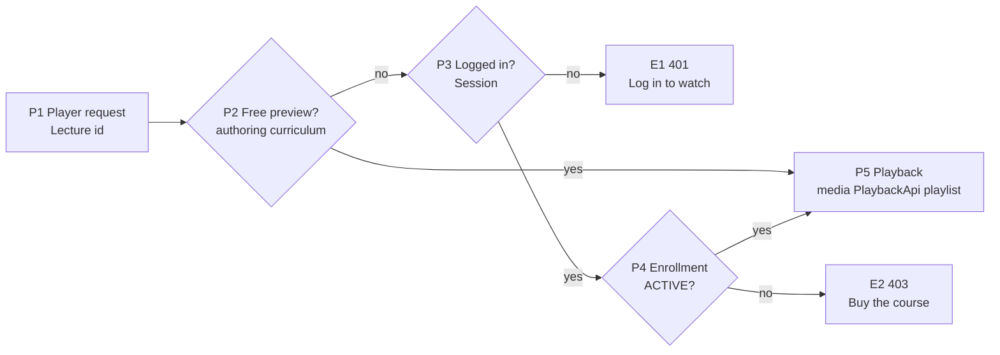

# Spec: learning — V1

Status: proposed · Module id: `learning` · Release: R1 · Depends on: `checkout`, `media`, `authoring`

Inherits Code Style, Testing Strategy, and Boundaries from [SPEC-platform.md](SPEC-platform.md).

## Objective

Let a student open "My learning", watch lectures in a good player, resume where they stopped, and see progress. Deny access to non-preview lectures for users who are not enrolled. This module closes the Release 1 end-to-end flow.

Stories: US-5.1 – US-5.6. Also: free preview playback (US-2.5 for visitors) and the `CourseConsumptionProvider` for refunds.

## Domain

| Object | Fields and rules |
|---|---|
| `Enrollment` | userId, courseId, source `PURCHASE`, status `ACTIVE | REVOKED`, enrolledAt, lastLectureId, lastActivityAt |
| `LectureProgress` | userId, lectureId, courseId, positionSeconds, watchedSeconds, completed, completedAt |
| Completion rule | `watchedSeconds ≥ 0.9 × durationSeconds` → completed (US-5.4). |
| Anti-skip rule | Each heartbeat adds at most `min(reported delta, 20 s)` to `watchedSeconds`. Seeking does not count as watching. |
| Course progress | completed lectures ÷ lectures in the published curriculum, as an integer %. |
| Watched % (refund) | Σ watchedSeconds ÷ total course duration, as an integer %. |
| Access rule | Lecture is free preview, or the user has an `ACTIVE` enrollment. No expiry (US-5.6). |

Enrollment comes from events: `OrderPaid` → create `ACTIVE`; `OrderLineRefunded` → `REVOKED`. Consumers are idempotent (unique userId + courseId).

## Access and playback

The access check runs on the master playlist request and on each rendition playlist request.

## Ports and adapters

| Kind | Name |
|---|---|
| Port in | `GetMyLearningUseCase`, `OpenLectureUseCase`, `RecordProgressUseCase`, `GetCourseProgressUseCase`, `DownloadAttachmentUseCase` |
| Port in (implements `checkout.api`) | `CourseConsumptionProvider` |
| Port out | `EnrollmentRepository`, `LectureProgressRepository`, `CurriculumPort` (→ `authoring.api.PublishedCourseQuery`), `PlaybackPort` (→ `media.api.PlaybackApi`), `LearningEventPublisher` |
| Adapter in | REST; `OrderEventsListener` |
| Adapter out | JPA (schema `learning`), outbox → Kafka |

## REST API

| Method | Path | Role | Purpose |
|---|---|---|---|
| GET | `/api/v1/my-learning?page` | user | Courses with progress %, last lecture, sorted by last activity (US-5.1) |
| GET | `/api/v1/learn/courses/{courseId}` | enrolled | Curriculum with completed flags and resume lecture |
| GET | `/api/v1/learn/lectures/{lectureId}` | enrolled or preview | Lecture info + resume position (US-5.3) |
| GET | `/api/v1/playback/lectures/{lectureId}/master.m3u8` | enrolled or preview | HLS master playlist |
| GET | `/api/v1/playback/{assetId}/{rendition}.m3u8` | enrolled or preview | Rendition playlist with signed segment URLs |
| PUT | `/api/v1/learn/lectures/{lectureId}/progress` | enrolled | Heartbeat `{ positionSeconds, deltaSeconds }` every 15 s and on pause/end |
| GET | `/api/v1/learn/attachments/{assetId}` | enrolled | 302 to a presigned download URL (US-5.5) |

## Events (`learning.progress.v1`, key = userId)

`LectureCompleted(userId, courseId, lectureId, at)`, `CourseProgressChanged(userId, courseId, percent, at)`. Consumers in R2: `engagement`, `certificates`.

## Frontend (`features/learning`)

| Route | Page |
|---|---|
| `/my-learning` | Grid of course cards with MUI `LinearProgress` and % label |
| `/learn/:courseId/lecture/:lectureId` | Player page: video, curriculum sidebar with check marks, attachments tab |

Player (hls.js in an MUI shell):
- Speed 0.5×–2× (US-5.2), quality menu (auto + renditions), captions track slot (WebVTT, filled in R2), full screen.
- Keyboard: Space/K play-pause, J/L ± 10 s, M mute, F full screen, C captions. All controls have accessible names.
- Resume: seek to `positionSeconds` on load (US-5.3). Auto-advance to the next lecture after 5 s countdown (cancelable).
- Progress UI updates when the server returns `completed: true` (US-5.4 "immediately").
- Grafana Faro reports video start time (`video_start_ms`) for the SLO in architecture §11.3.

## Testing

- Domain: `recordHeartbeat_deltaAbove20_addsOnly20`, `recordHeartbeat_reaches90Percent_marksCompleted`, `courseProgress_3of10Completed_returns30`.
- Service: `openLecture_notEnrolledNotPreview_throwsAccessDenied`, `onOrderPaid_sameEventTwice_createsOneEnrollment`.
- Module: `refund_afterOrderLineRefunded_lectureAccessDenied`.
- Security: request a rendition playlist of course B with an enrollment in course A → 403.
- E2E (Release 1 flow): instructor publishes → admin approves → student finds, buys, watches to 90% → lecture checked, progress shows.
- Load (k6): 10 000 virtual viewers fetch playlists and post heartbeats; p95 < 300 ms; no errors.
- Security scan: OWASP ZAP baseline against the full local stack; no high findings.

## Success Criteria

1. "My learning" lists all courses with `ACTIVE` enrollment and correct progress %.
2. Player plays HLS with speed and quality controls; video start p95 < 2 s locally (Faro metric).
3. Close the tab at 4:10, reopen → playback resumes within ± 15 s of 4:10.
4. Watching ≥ 90% marks the lecture complete; seeking to the end does not.
5. A non-enrolled user opening a non-preview lecture URL gets 403; a visitor can play a preview lecture without login.
6. After a refund, the course leaves "My learning" and its playlists return 403.
7. `CourseConsumptionProvider.watchedPercent` matches the refund rule in [SPEC-checkout.md](SPEC-checkout.md).
8. The full Release 1 E2E test, k6 test, and ZAP scan pass (plan Sprint 6 exit check).

## Out of Scope (Deferred)

- Notes, Q&A, reviews in the player — R2 `engagement`.
- Certificates at 100% — R2 `certificates`.
- Offline video download — not planned (content protection).
- Captions content — R2 `ai-assistant` (transcripts).

## Open Questions

1. Is 90% the completion threshold for every lecture type? (Articles and quizzes come later.)
