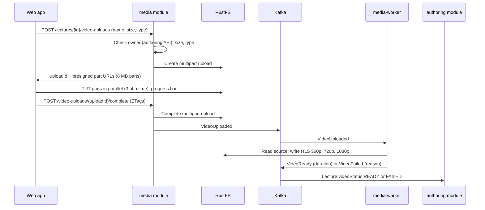
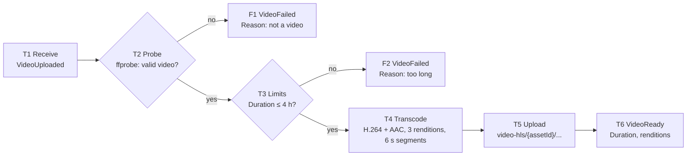

# Spec: media — V1

Status: proposed · Module id: `media` · Release: R1 · Depends on: `authoring`

Inherits Code Style, Testing Strategy, and Boundaries from [SPEC-platform.md](SPEC-platform.md).

## Objective

Let an instructor upload lecture videos and attachments directly to object storage. Convert each video to HLS. Give the `learning` module short-lived playback and download URLs. The backend never streams large files.

Stories: US-2.3 (video upload), US-2.4 (attachments), US-5.5 (download attachments, URL part).

## Components

| Component | Where | Job |
|---|---|---|
| `media` module | `backend/marketplace-api`, package `com.marketplace.media` | Upload sessions, asset records, signed URLs, playlist rewrite |
| `media-worker` | Maven module `backend/media-worker`, own container with FFmpeg | Consume `VideoUploaded`, probe, transcode to HLS, publish result |

## Domain

| Object | Fields and rules |
|---|---|
| `MediaAsset` | id, lectureId, kind `VIDEO | ATTACHMENT`, objectKey, fileName, sizeBytes, contentType, status `UPLOADING | UPLOADED | PROCESSING | READY | FAILED`, durationSeconds, failureReason |
| Video rules | MP4 or MOV, ≤ 4 GB, ≤ 4 h. One active video per lecture; a new upload replaces the old one after `READY`. |
| Attachment rules | PDF, ZIP, TXT, MD, source code extensions list; ≤ 100 MB; ≤ 10 per lecture |

## Upload flow (S3 multipart, presigned)

The instructor can leave the page and edit other lectures during the upload (US-2.3). An incomplete multipart upload is aborted after 24 h (S3 lifecycle rule).

## Transcode (media-worker)

- Consumer group `media-worker`, concurrency 2 per container. Retry 3 times with backoff, then topic `media.video.v1.dlq`.
- Idempotent: the output path is `video-hls/{assetId}/`; a re-run overwrites it.
- FFmpeg runs as a child process with a timeout of 3 × video duration. Arguments are built as a list, never as one shell string.

## Playback (used by `learning`)

`media.api.PlaybackApi`:
- `masterPlaylist(lectureId, viewerId)` → returns the HLS master playlist text. Each rendition URL points to `/api/v1/playback/{assetId}/{rendition}.m3u8`.
- `renditionPlaylist(assetId, rendition, viewerId)` → returns the media playlist with each segment URL replaced by an S3 presigned GET URL (RustFS) (life 4 h).
- `attachmentDownloadUrl(assetId)` → presigned GET, life 5 min, `Content-Disposition: attachment`.

`media` does not check enrollment. `learning` checks access, then calls `PlaybackApi`. No raw MP4 URL is ever returned (US-2.3 rule).

## REST API (role `instructor`, owner of the lecture)

| Method | Path | Purpose |
|---|---|---|
| POST | `/api/v1/lectures/{lectureId}/video-uploads` | Start video upload |
| POST | `/api/v1/video-uploads/{uploadId}/complete` | Finish upload |
| DELETE | `/api/v1/video-uploads/{uploadId}` | Cancel upload |
| POST | `/api/v1/lectures/{lectureId}/attachments` | Presigned PUT for an attachment |
| GET | `/api/v1/lectures/{lectureId}/media` | Video status, duration, attachments list |
| DELETE | `/api/v1/attachments/{assetId}` | Delete attachment |

## Events (`media.video.v1`, key = lectureId)

`VideoUploaded(assetId, lectureId, objectKey)`, `VideoReady(assetId, lectureId, durationSeconds, renditions)`, `VideoFailed(assetId, lectureId, reason)`.

## Storage (RustFS)

| Bucket | Lifecycle |
|---|---|
| `uploads-raw` | Abort incomplete multipart after 24 h. Delete source 30 days after `READY`. |
| `video-hls` | Keep. Delete when the lecture is deleted. |
| `attachments` | Keep. Delete with the asset. |

CORS on RustFS allows `PUT` from `http://localhost:5173` and exposes the `ETag` header.

## Frontend

- `features/media/VideoUploader`: file picker, client-side type and size check, parallel part upload, progress bar, cancel, retry of a failed part.
- Status chip per lecture: Uploading %, Processing, Ready (duration), Failed (reason).

## Testing

- Domain: `startUpload_fileOver4GB_throwsRuleViolation`, `startUpload_typeAvi_listsAllowedFormats`.
- Worker: `transcode_sampleMp4_writesThreeRenditions` with a 10 s fixture video and a RustFS Testcontainer (GenericContainer with `docker.io/rustfs/rustfs:1.0.6`).
- Worker: `transcode_textFileRenamedMp4_publishesVideoFailed`.
- Playback: `renditionPlaylist_rewritesEverySegmentToPresignedUrl`.
- E2E: upload a 20 MB fixture → status becomes "Ready" with duration in < 2 min locally.

## Success Criteria

1. A 1 GB MP4 upload from the browser does not pass through the backend (verified by backend network metrics) and shows progress.
2. A wrong format is rejected before the upload starts, with the message "Allowed formats: MP4, MOV".
3. After processing, the lecture shows `READY` and the right duration (± 1 s).
4. The HLS output plays in hls.js at 360p, 720p, and 1080p (or the source height if lower).
5. A worker crash during transcode leads to a retry; after 3 failures the event is in the DLQ and the lecture shows `FAILED`.
6. A segment URL stops working after its life ends (403 from RustFS).

## Out of Scope (Deferred)

- DRM and watermark — plan says later release.
- CDN with signed cookies — needs cloud deployment.
- Automatic captions — R2 with `ai-assistant`.
- Managed transcoding (Mux, MediaConvert) — adapter swap later.

## Open Questions

1. Is 1080p the highest rendition, or do we need 4K?
2. Is the 4 h segment URL life acceptable for piracy risk? Shorter means the player must reload the playlist.
