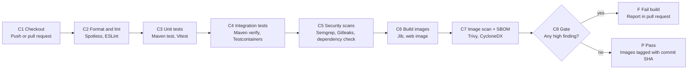

# Spec: platform — V1

Status: proposed · Module id: `platform` · Release: R1 · Depends on: —

## Objective

Give every other module a working foundation: repository layout, build, local infrastructure, CI with security gates, observability, and shared test setup. No business feature is in this module.

The other module specs inherit the **Code Style**, **Testing Strategy**, and **Boundaries** sections of this spec. They state only their differences.

## Tech Stack

| Area | Technology | Version (pin in build files) |
|---|---|---|
| Language | Java | 25 (LTS) |
| Framework | Spring Boot, Spring Modulith | 4.0.x, 2.0.x |
| Gateway | Spring Cloud Gateway Server Web MVC | Spring Cloud 2025.1.x |
| Build | Maven Wrapper | 3.9.x |
| Local container engine | Podman (WSL machine) + podman-compose | Podman 6.0, podman-compose 1.6 |
| Frontend | React, TypeScript, MUI, Vite | 19, 5.x, 7, 7 |
| Frontend libs | TanStack Query, React Router, React Hook Form, Zod, Orval, hls.js | latest stable at S1 start |
| Node | Node.js LTS | 24 |
| Database | PostgreSQL + pgvector image | 18 |
| Messaging | Apache Kafka (KRaft) | 4.1 |
| Cache | Valkey (Redis API) | 8 |
| Search | OpenSearch | 3 |
| Object storage | RustFS (S3 API) | 1.0.6 (`docker.io/rustfs/rustfs:1.0.6`) |
| Identity | Keycloak | 26 |
| Email (local) | Mailpit | v1.34.0 |
| Observability | Grafana Alloy, Prometheus, Tempo, Loki, Grafana | latest stable at S1 start |
| Load test | Grafana k6 | latest |

## Commands

Run Maven commands in `backend/` (`cd backend`). Run all other commands in the repository root. Windows: use `mvnw.cmd` in place of `./mvnw`.

```text
Infra up:        podman compose -f infra/compose.yaml up -d
Infra down:      podman compose -f infra/compose.yaml down
Infra reset:     podman compose -f infra/compose.yaml down -v
Backend run:     ./mvnw -pl marketplace-api spring-boot:run
BFF run:         ./mvnw -pl bff-gateway spring-boot:run
Worker run:      ./mvnw -pl media-worker spring-boot:run
All tests:       ./mvnw verify
Unit tests only: ./mvnw test
Format Java:     ./mvnw spotless:apply
Check Java:      ./mvnw spotless:check
Web install:     npm --prefix frontend ci
Web dev:         npm --prefix frontend run dev
Web test:        npm --prefix frontend test
Web lint:        npm --prefix frontend run lint
Web build:       npm --prefix frontend run build
API client:      npm --prefix frontend run api:generate
E2E tests:       npm --prefix frontend run e2e
Load test:       podman compose -f infra/compose.yaml --profile tools run --rm k6 run /scripts/<name>.js
```

## Local container engine

The developer machine (Windows) uses Podman 6 with the WSL provider, not Docker. `podman compose` reads `infra/compose.yaml` through the compose provider `podman-compose` (Python).

```text
podman machine init --cpus 6 --memory 12288
podman machine start
pip install --user podman-compose
# Add %APPDATA%\Python\Python3xx\Scripts to the user PATH, then: podman compose version
```

- WSL provider: the machine memory comes from WSL (`%USERPROFILE%\.wslconfig`), not from `--memory`. Check with `podman info --format "{{.Host.MemTotal}}"`; the stack needs about 4 GB in Phase 2 and 8 GB with observability.
- If `podman machine list` shows "Currently starting" but `wsl -l -v` shows the machine "Stopped", the state is stale: run `podman machine stop`, then `podman machine start`.
- Podman exposes the Docker API on `npipe:////./pipe/docker_engine`, so Docker API clients find it without `DOCKER_HOST`.
- All published ports bind to `127.0.0.1`: the services are not reachable from the local network.

- Rootless mode is enough (verified in T09): Testcontainers finds Podman through `npipe:////./pipe/docker_engine` without any configuration, and the Ryuk cleanup container works.
- Testcontainers images must be declared compatible when the name is fully qualified: `DockerImageName.parse("docker.io/apache/kafka:4.1.1").asCompatibleSubstituteFor("apache/kafka")`.
- If Ryuk fails on another machine, set `TESTCONTAINERS_RYUK_DISABLED=true`. This is the last resort: the test run then does not remove its containers.
- Every image name in `compose.yaml` is fully qualified (`docker.io/...`, `quay.io/...`). Podman can ask which registry to use for a short name.
- File names stay `Dockerfile`. Podman reads them.

## Local ports

| Service | Port | Note |
|---|---|---|
| Web (Vite dev) | 5173 | Proxies `/api`, `/bff`, `/oauth2`, `/login`, `/logout` to the BFF |
| BFF gateway | 8080 | The only entry point for the browser |
| Backend API | 8090 | Not called by the browser |
| Backend management | 8091 | Actuator: health, prometheus |
| Keycloak | 8180 | Admin console |
| PostgreSQL | 5432 | One database `marketplace`, one schema per module |
| Kafka | 9092 | |
| Valkey | 6379 | |
| OpenSearch | 9200 | |
| RustFS | 9000 / 9001 | S3 API / web console |
| Mailpit | 8025 / 1025 | Web UI / SMTP |
| Grafana | 3000 | Prometheus, Tempo, Loki are data sources |

## Project Structure

```text
udemy/
├── backend/                     → Maven root: run all Maven commands here
│   ├── pom.xml                  → Maven parent: versions, plugins, Spotless, JaCoCo
│   ├── mvnw, mvnw.cmd
│   ├── .mvn/wrapper/            → Maven Wrapper
│   ├── .mvn/settings.xml        → Project-only Maven settings: Maven Central; ignores global or company settings
│   ├── .mvn/maven.config        → Loads .mvn/settings.xml as user and global settings
│   ├── marketplace-api/         → Spring Boot modular monolith (artifact `marketplace-api`)
│   │   └── src/main/java/com/marketplace/
│   │       ├── MarketplaceApplication.java
│   │       ├── shared/          → Shared kernel: Money, PageQuery, PageResult, problem handling
│   │       └── <module>/        → identity, authoring, catalog, checkout, learning, admin, media
│   │           ├── api/         → Public API and events for other modules
│   │           ├── domain/      → Pure Java
│   │           ├── application/ → port/in, port/out, service
│   │           └── adapter/     → in/web, in/event, out/persistence, out/<tech>
│   │   └── src/main/resources/db/migration/<module>/  → Flyway scripts per schema
│   │   └── src/test/java/...    → Same packages as main
│   ├── bff-gateway/             → Spring Cloud Gateway (BFF)
│   └── media-worker/            → FFmpeg transcode worker
├── frontend/                    → React + MUI + Vite
│   └── src/
│       ├── app/                 → Router, MUI theme, providers
│       ├── shared/api/          → Orval output (generated, do not edit)
│       ├── shared/ui/           → Shared components
│       └── features/<module>/   → One folder per module
│   └── e2e/                     → Playwright tests
├── infra/
│   ├── compose.yaml
│   ├── keycloak/marketplace-realm.json
│   ├── observability/           → Alloy, Prometheus, Tempo, Loki config; Grafana dashboards
│   └── k6/                      → Load test scripts
├── .github/workflows/ci.yml     → Maven steps: working-directory `backend`; npm steps: `frontend`
├── docs/
├── spec/
├── tasks/
└── .gitignore, .gitattributes, .editorconfig
```

## Code Style

Java: Spotless with `palantir-java-format`. TypeScript: Prettier + ESLint (`typescript-eslint` strict, `jsx-a11y`).

Rules (from the user's global instructions):
- Functions 4–20 lines. Files under 500 lines. Max 2 levels of indentation; use early returns.
- Specific names. No `data`, `handler`, `Manager`, `Util`.
- Explicit types. No raw types, no `Object` parameters, no `any` in TypeScript.
- Exception messages include the bad value and the expected shape.
- Comments say WHY. Public functions have a docstring with intent and one usage example.
- Dependencies through the constructor. Third-party libraries behind a port owned by the module.
- Structured JSON logs. No personal data in logs.

```java
/**
 * Checks that a price is in the fixed price list (US-2.6).
 * Example: PriceTier.of(1999L) returns TIER_1999.
 */
public static PriceTier of(long amountMinor) {
    return Arrays.stream(values())
        .filter(tier -> tier.amountMinor == amountMinor)
        .findFirst()
        .orElseThrow(() -> new CourseRuleViolationException(
            "Price " + amountMinor + " is not in the price list " + Arrays.toString(values())));
}
```

```tsx
type CourseCardProps = { title: string; priceLabel: string; onOpen: (courseId: string) => void; courseId: string };

export function CourseCard({ title, priceLabel, onOpen, courseId }: CourseCardProps): JSX.Element {
  return (
    <Card>
      <CardActionArea onClick={() => onOpen(courseId)}>
        <CardContent>
          <Typography variant="h6" component="h3">{title}</Typography>
          <Typography>{priceLabel}</Typography>
        </CardContent>
      </CardActionArea>
    </Card>
  );
}
```

## Testing Strategy

| Level | Tool | Location | Runs in |
|---|---|---|---|
| Domain unit | JUnit 5, AssertJ | `backend/marketplace-api/src/test/.../domain` | `./mvnw test` |
| Service unit | JUnit 5 + named fake classes (`FakeCourseRepository`) | `.../application` | `./mvnw test` |
| Web slice | `@WebMvcTest`, MockMvc | `.../adapter/in/web` | `./mvnw test` |
| Adapter integration | Testcontainers (`@ServiceConnection`), suffix `*IT` | `.../adapter/out` | `./mvnw verify` |
| Module | Spring Modulith `@ApplicationModuleTest`, `Scenario` | `.../<module>` | `./mvnw verify` |
| Architecture | ArchUnit, `ApplicationModules.verify()` | `backend/marketplace-api/src/test/.../architecture` | `./mvnw test` |
| Frontend unit | Vitest, Testing Library, MSW | `frontend/src/**/*.test.tsx` | `npm test` |
| End to end | Playwright + axe-core | `frontend/e2e` | `npm run e2e` |
| Load | k6 | `infra/k6` | Manual, S6 |

- Test names: `methodName_stateUnderTest_expectedResult`.
- Mocks: named fake classes. No inline Mockito stubs for ports.
- Coverage (JaCoCo): 80% lines for `domain` and `application` packages. The build fails below it.
- Testcontainers use one shared container per type for the whole test run (reuse).
- Locally, Testcontainers runs on Podman. See "Local container engine" for `.testcontainers.properties` and the Ryuk fallback.

## CI pipeline



- `ci.yml` stays at the repository root. Maven steps use `working-directory: backend`. npm steps use `working-directory: frontend`.
- GitHub runners use their own Docker engine, not Podman. The images are OCI images, so the result is the same as a local Podman build.

## Security baseline

- Every container uses a non-root user and a pinned image tag.
- Every image name in `compose.yaml` is fully qualified (`docker.io/...`, `quay.io/...`). Podman does not resolve short names without a question.
- `infra/.env.example` holds all secrets with dummy values. `infra/.env` is in `.gitignore`.
- Kafka, Valkey, OpenSearch, RustFS, PostgreSQL require a password, also locally. RustFS reads its credentials from `RUSTFS_ACCESS_KEY` and `RUSTFS_SECRET_KEY`.
- Actuator is on the management port only. Exposed endpoints: `health`, `info`, `prometheus`.
- One Problem Details handler in `shared`. No stack trace in responses.

## Observability baseline

- Backend, BFF, and worker send traces with OTLP to Alloy. Sampling 100% locally.
- Logs are JSON (`logging.structured.format.console: ecs`) with `trace_id`.
- Prometheus scrapes the management ports and the infrastructure exporters.
- Grafana starts with the dashboards "Service overview" and "Kafka" from `infra/observability/dashboards`.

## Boundaries

- **Always:** run `./mvnw verify` (in `backend/`) and `npm --prefix frontend test` before you hand over work. Follow Hexagonal package rules. Validate every input at the adapter. Add a Flyway script for each schema change.
- **Ask first:** add a dependency. Change `compose.yaml` ports. Change the CI pipeline. Change a Kafka event contract in an `api` package. Lower a coverage or security threshold.
- **Never:** commit secrets. Run `git commit` (the user commits). Edit generated code in `frontend/src/shared/api/generated`. Delete or skip a failing test without approval. Read another module's tables.

## Success Criteria

1. `podman compose -f infra/compose.yaml up -d` starts all services; each reports healthy within 3 minutes on a developer laptop.
2. `cd backend` then `./mvnw verify` passes on a clean clone, including one ArchUnit test and `ApplicationModules.verify()`.
3. `GET http://localhost:8091/actuator/health` returns `{"status":"UP"}`.
4. A request to `GET /api/v1/ping` through the BFF shows one trace in Tempo with spans from BFF and backend, and the log line in Loki has the same `trace_id`.
5. Prometheus shows `http_server_requests_seconds_count` for backend and BFF.
6. CI runs all stages of the pipeline diagram; a planted test secret makes Gitleaks fail the build.
7. `npm --prefix frontend run dev` shows an MUI app shell with a header and an empty home page; `npm --prefix frontend test` and `npm --prefix frontend run lint` pass.

## Out of Scope (Deferred)

- Kubernetes, Helm, Argo CD — decision: local Podman only for this version.
- Image signing with cosign — needs a container registry.
- OWASP ZAP baseline scan — added in `learning` (S6) when the full flow exists.
- Grafana Faro frontend telemetry — add when the player exists (`learning`).

## Open Questions

None. (Resolved 2026-11-23: Git host is GitHub, `github.com/duynvh/udemy-platform`; CI uses GitHub Actions.)
