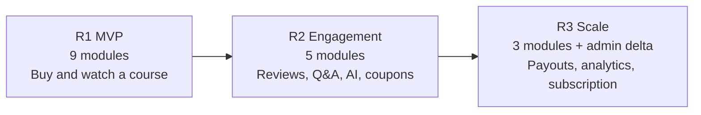
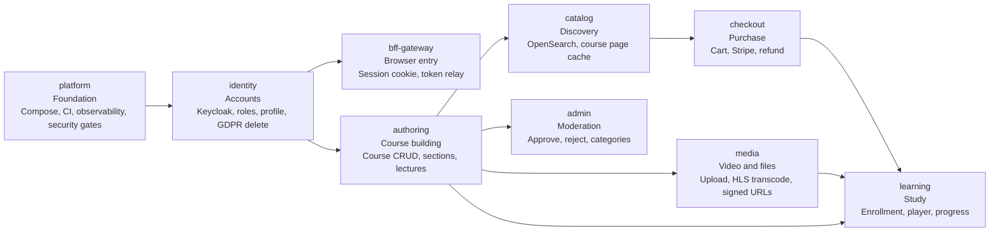
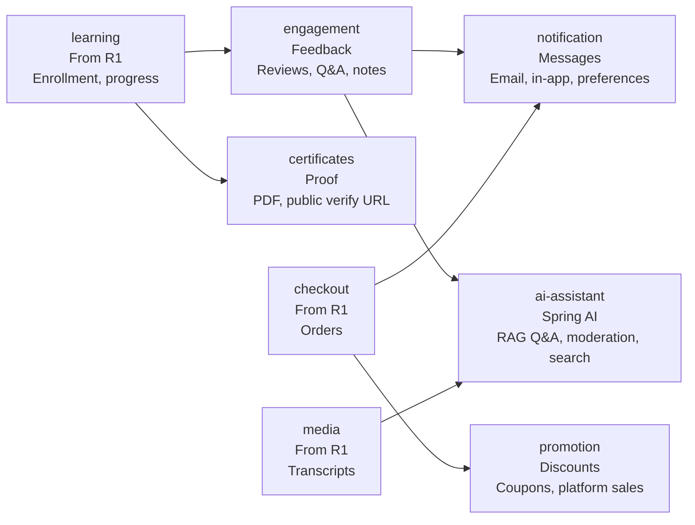
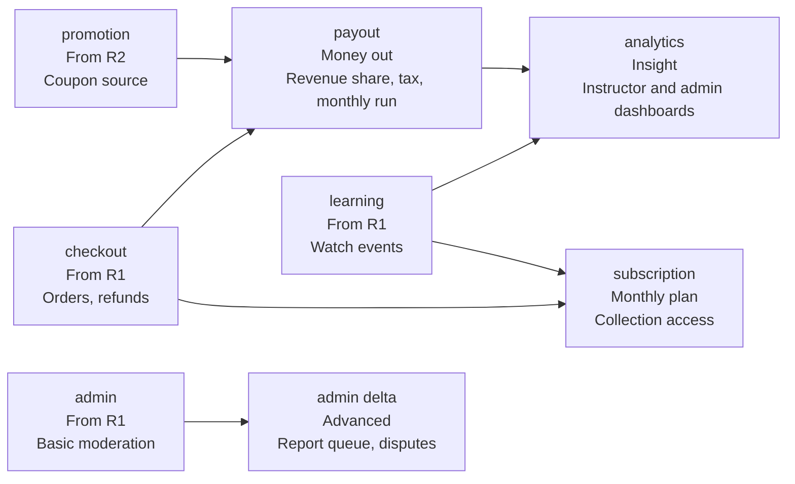

# Capability Map: Online Course Marketplace

Status: approved (2026-11-23)

Inputs: [course-marketplace-plan.md](../docs/course-marketplace-plan.md), [architecture.md](../docs/architecture.md)

## Decisions already made

| Item | Decision |
|---|---|
| Build tool | Maven, multi-module |
| Browser authentication | Backend-for-Frontend (BFF), `HttpOnly` session cookie (ADR-007) |
| Deployment target | Local Podman Compose only (`infra/compose.yaml`). Kubernetes is deferred. |
| Backend style | Modular monolith (Spring Modulith). Hexagonal Architecture per module. |

## Assumptions

1. One backend deployable (`backend/marketplace-api`) holds all business modules. The BFF is a second deployable.
2. One React app serves student, instructor, and admin UI. Role decides the visible menu.
3. Payment provider is Stripe in test mode. Video processing is a local FFmpeg worker that writes HLS to RustFS (no Mux account needed for local work).
4. Release 1 supports USD only.
5. Modules communicate through Kafka events or a module's public `api` package. No module reads another module's tables.

→ Correct these now, or the module specs use them.

## Level 1 — Releases

## Level 2 — Release 1 modules

## Level 2 — Release 2 modules

## Level 2 — Release 3 modules

## Module table

| Module id | Release | Responsibility | Stories | Depends on |
|---|---|---|---|---|
| `platform` | R1 | Repository layout, Maven parent, Podman Compose stack (`compose.yaml`), CI pipeline, security gates, observability stack, shared test setup | NFRs | — |
| `identity` | R1 | Keycloak realm, roles, become instructor, profile, account deletion | US-1.1 – 1.7 | platform |
| `bff-gateway` | R1 | Login flow, session cookie, token relay, CSRF, rate limit, security headers | US-1.3 | identity |
| `authoring` | R1 | Course draft CRUD, sections, lectures, price, submit for review | US-2.1 – 2.8 | identity |
| `media` | R1 | Presigned upload, FFmpeg HLS transcode, attachments, signed playback URLs | US-2.3, 2.4, 5.5 | authoring |
| `catalog` | R1 | Search index, filters, sort, category browse, course page, wishlist | US-3.1 – 3.6 | authoring |
| `admin` | R1 | Course approval, categories, suspend user, unpublish course | US-9.1 – 9.3 | authoring, identity |
| `checkout` | R1 | Cart, Stripe payment, receipt, refund, purchase history | US-4.1 – 4.6 | catalog, identity |
| `learning` | R1 | My learning, player, resume, progress, access check, lifetime access | US-5.1 – 5.6 | checkout, media, authoring |
| `engagement` | R2 | Ratings, reviews, Q&A, notes, announcements | US-6.x, 7.x | learning |
| `certificates` | R2 | Certificate on 100%, public verify URL | US-8.1, 8.2 | learning |
| `promotion` | R2 | Instructor coupons, platform sales | US-10.x | checkout |
| `notification` | R2 | Email and in-app notifications, preferences | US-11.x | engagement, checkout |
| `ai-assistant` | R2 | RAG Q&A on transcripts, moderation, semantic search, description helper | architecture §7 | engagement, media |
| `payout` | R3 | Payout method, tax data, monthly payout, finance report | US-12.x | checkout, promotion |
| `analytics` | R3 | Instructor revenue and engagement, admin business dashboard | US-13.x, 14.2 | payout, learning |
| `subscription` | R3 | Monthly plan for a course collection | US-15.1 | checkout, learning |

`admin` advanced (US-14.1) is a delta spec on `admin`, not a new module.

## Build order

1. `platform`
2. `identity`
3. `bff-gateway` and `authoring` (parallel)
4. `media`, `catalog`, `admin` (parallel)
5. `checkout`
6. `learning`
7. R2: `engagement`, `certificates`, `promotion` (parallel) → `notification`, `ai-assistant`
8. R3: `payout`, `subscription` (parallel) → `analytics` → `admin` delta

## Cross-module decisions (found while writing the module specs)

| Decision | Reason |
|---|---|
| `authoring` owns categories; `admin` manages them through `CategoryAdminApi`. | `authoring` validates the category. Ownership in `admin` creates a cycle. |
| `checkout` declares `CourseConsumptionProvider`; `learning` implements it. | The refund rule needs watched %, but `learning` depends on `checkout`. |
| `learning` checks access, then calls `media.api.PlaybackApi`. | `media` stays free of enrollment logic. |
| `catalog` builds its read model through `authoring.api.PublishedCourseQuery`. | Events stay small; one source of course data. |

## Spec files

| Module id | Spec | Status |
|---|---|---|
| `platform` | [SPEC-platform.md](SPEC-platform.md) | proposed |
| `identity` | [SPEC-identity.md](SPEC-identity.md) | proposed |
| `bff-gateway` | [SPEC-bff-gateway.md](SPEC-bff-gateway.md) | proposed |
| `authoring` | [SPEC-authoring.md](SPEC-authoring.md) | proposed |
| `media` | [SPEC-media.md](SPEC-media.md) | proposed |
| `catalog` | [SPEC-catalog.md](SPEC-catalog.md) | proposed |
| `admin` | [SPEC-admin.md](SPEC-admin.md) | proposed |
| `checkout` | [SPEC-checkout.md](SPEC-checkout.md) | proposed |
| `learning` | [SPEC-learning.md](SPEC-learning.md) | proposed |
| R2 and R3 modules | Not written yet | Written after Release 1, with what we learn from it |

Each module spec covers: objective, commands, structure, code style, testing, boundaries, success criteria, deferred items, open questions.
