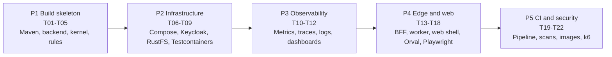
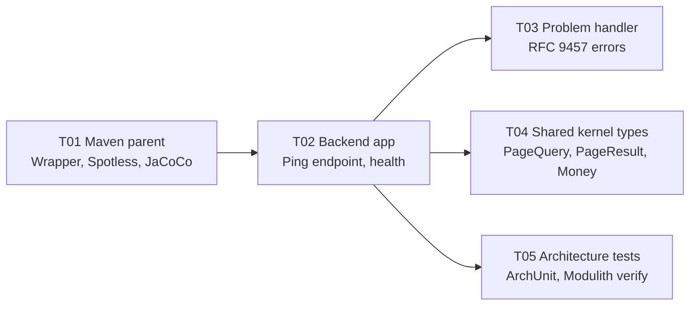
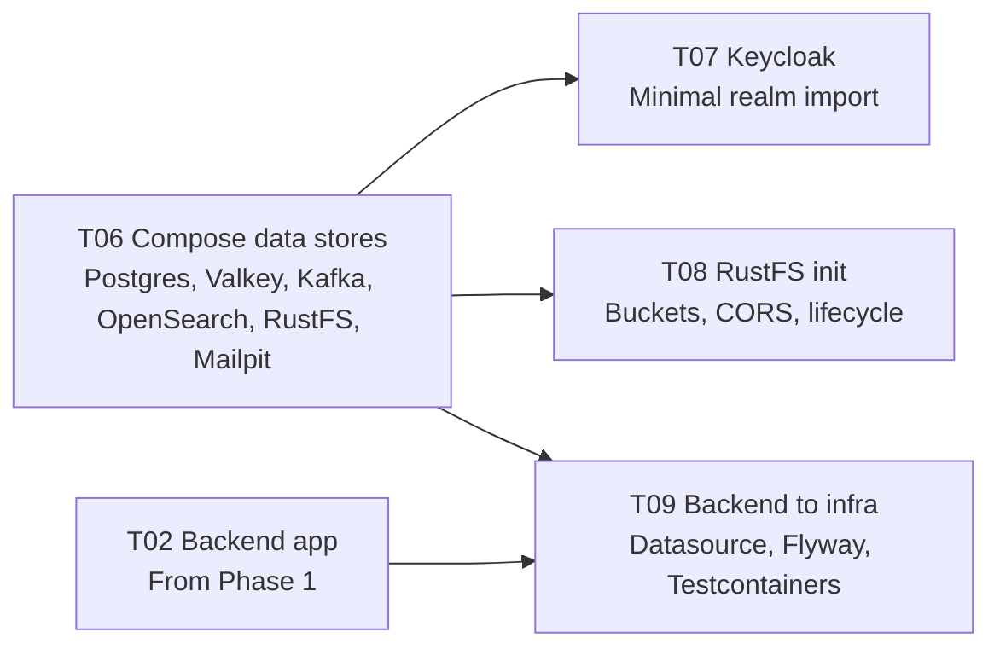
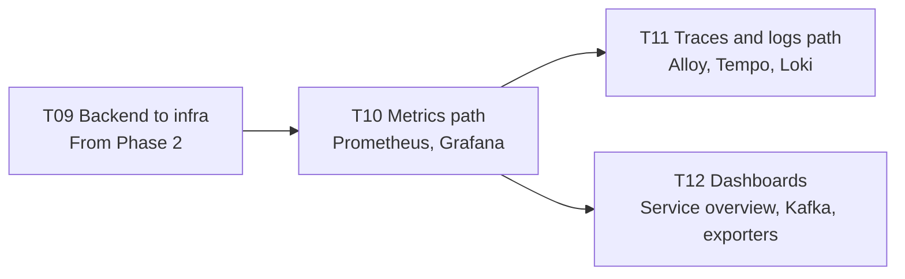
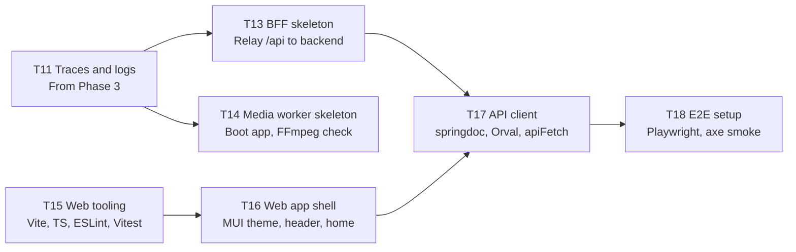
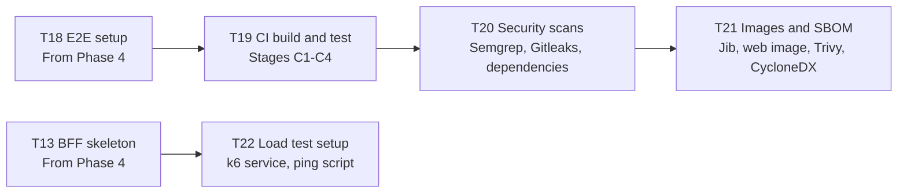

# Implementation Plan: platform

Source spec: [spec/SPEC-platform.md](../spec/SPEC-platform.md) · Capability map: [spec/capability-map.md](../spec/capability-map.md)

## Overview

Build the foundation that every business module uses: Maven build, backend skeleton, shared kernel, architecture tests, local infrastructure in `infra/compose.yaml` on Podman, observability, BFF and worker skeletons, web app shell, and CI with security gates. No business feature.

Repository layout: `backend/` is the Maven root (parent `pom.xml`, wrapper, modules `marketplace-api`, `bff-gateway`, `media-worker`). `frontend/` holds the React app. Run Maven commands in `backend/`.

Each task is in its own file in [`tasks/platform/`](platform/). The checklist is in [todo.md](todo.md).

## Architecture Decisions

- **Walking skeleton first.** `GET /api/v1/ping` is the one path that crosses web → BFF → backend. Every phase makes this path observable or safer. Business modules replace it later.
- **Compose is independent from Maven.** `infra/` and `backend/` do not share files. Phase 2 can run in parallel with Phase 1.
- **Testcontainers for tests, Compose for running.** Tests never need `podman compose up`. Both run on the local Podman machine.
- **Minimal Keycloak realm here.** Only the realm and clients needed for the BFF route. Full realm settings (MFA, password policy, roles) are in the `identity` plan.
- **No OAuth in the BFF yet.** The BFF here is a plain relay. Login, session, and CSRF are in the `bff-gateway` plan.
- **ArchUnit rules allow empty matches.** There are no business modules yet. `allowEmptyShould(true)` keeps the rules active for later modules.

## Dependency graph

### Level 1 — Phases

### Level 2 — Phase 1: Build skeleton

### Level 2 — Phase 2: Infrastructure

### Level 2 — Phase 3: Observability

### Level 2 — Phase 4: Edge and web

### Level 2 — Phase 5: CI and security

## Task List

### Phase 1: Build skeleton
- [ ] [T01 Maven parent and wrapper](platform/T01-maven-parent.md) — S
- [ ] [T02 Backend application with ping endpoint](platform/T02-backend-app.md) — M
- [ ] [T03 Problem Details handler](platform/T03-problem-handler.md) — S
- [ ] [T04 Shared kernel types](platform/T04-shared-kernel-types.md) — M
- [ ] [T05 Architecture tests](platform/T05-architecture-tests.md) — S

### Checkpoint 1: Build skeleton
- [ ] `./mvnw verify` passes on a clean clone
- [ ] `GET http://localhost:8091/actuator/health` returns `UP` (backend has no database dependency yet)
- [ ] Human review

### Phase 2: Infrastructure
- [ ] [T06 Compose data stores](platform/T06-compose-data-stores.md) — M
- [ ] [T07 Keycloak with minimal realm](platform/T07-keycloak-minimal-realm.md) — S
- [ ] [T08 RustFS buckets init](platform/T08-rustfs-init.md) — S
- [ ] [T09 Backend connects to infrastructure](platform/T09-backend-infra-connection.md) — M

### Checkpoint 2: Infrastructure
- [ ] All Compose services healthy in < 3 min (spec criterion 1, without observability)
- [ ] Backend starts against Compose and runs Flyway
- [ ] `./mvnw verify` passes with Testcontainers
- [ ] Human review

### Phase 3: Observability
- [ ] [T10 Metrics path](platform/T10-metrics-path.md) — M
- [ ] [T11 Traces and logs path](platform/T11-traces-logs-path.md) — M
- [ ] [T12 Dashboards and exporters](platform/T12-dashboards-exporters.md) — M

### Checkpoint 3: Observability
- [ ] Spec criterion 5: Prometheus shows `http_server_requests_seconds_count` for backend
- [ ] Ping trace in Tempo; its log line in Loki has the same `trace_id`
- [ ] Human review

### Phase 4: Edge and web
- [ ] [T13 BFF skeleton](platform/T13-bff-skeleton.md) — M
- [ ] [T14 Media worker skeleton](platform/T14-media-worker-skeleton.md) — S
- [ ] [T15 Web tooling](platform/T15-web-tooling.md) — M
- [ ] [T16 Web app shell](platform/T16-web-app-shell.md) — M
- [ ] [T17 API client generation](platform/T17-api-client.md) — M
- [ ] [T18 E2E setup](platform/T18-e2e-setup.md) — S

### Checkpoint 4: Edge and web
- [ ] Spec criterion 4: ping through BFF gives one trace with BFF and backend spans
- [ ] Spec criterion 7: web shell runs; web test and lint pass
- [ ] Human review

### Phase 5: CI and security
- [ ] [T19 CI build and test stages](platform/T19-ci-build-test.md) — S
- [ ] [T20 Security scans](platform/T20-security-scans.md) — M
- [ ] [T21 Images and SBOM](platform/T21-images-sbom.md) — M
- [ ] [T22 Load test setup](platform/T22-load-test-setup.md) — S

### Checkpoint 5: Complete
- [ ] All 7 success criteria in SPEC-platform.md pass
- [ ] Human review, then mark the spec `implemented`

## Parallel work

| Can run in parallel | Reason |
|---|---|
| T01–T05 and T06–T08 | Maven and Compose do not share files. Only T09 needs both phases. |
| T03, T04, T05 | Independent files after T02 |
| T07, T08 | Independent Compose services |
| T14, T15–T16 | Worker and web do not share files |
| T22 and T19–T21 | k6 does not touch CI |

Must be sequential: changes to `infra/compose.yaml` (T06 → T07 → T08 → T10 → T11 → T12 → T22) because each task edits the same file.

## Risks and Mitigations

| Risk | Impact | Mitigation |
|---|---|---|
| Spring Boot 4 / Spring Cloud 2025.1 / Spring Modulith 2 version mismatch | High | T01 pins versions with the Spring Cloud BOM; T13 fails fast if the gateway does not start. |
| Podman machine memory: 14+ containers | Medium | Podman machine with 12 GB (`--memory 12288`). OpenSearch heap 512 MB, Kafka heap 512 MB, Keycloak dev mode. Document ≥ 16 GB host RAM. |
| Testcontainers on Podman (Ryuk, Docker API socket) | Medium | Rootful Podman machine; `docker.host` in `.testcontainers.properties`; `TESTCONTAINERS_RYUK_DISABLED=true` as last resort (T09). |
| Windows line endings break shell scripts in containers | Medium | `.gitattributes` with `*.sh text eol=lf` in T01. |
| Gitleaks and CI need a Git repository; the workspace is not one | Medium | T19–T20 are written but verified only after the user runs `git init` and pushes. |
| RustFS is young (1.0 in 2026). It replaced MinIO: the MinIO community edition went into maintenance mode in 2025, and its Docker Hub images are no longer published. | Low | Only the S3 API is used, behind ports (`FileStoragePort`, `AvatarStoragePort`). AWS S3, SeaweedFS, or Garage stay possible as a Compose change. |
| Jib base image for the worker needs FFmpeg | Low | T21 uses a pinned base image with FFmpeg, or a Dockerfile for the worker only. |

## Open Questions

1. Git host: GitHub Actions is assumed for T19–T21. Confirm or name another host.
2. Can your Podman machine get 12 GB memory (`podman machine init --memory 12288`)?
